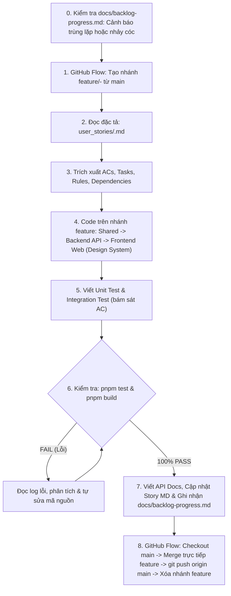

# ĐỊA CHÍNH SỐ - QUY CHUẨN VẬN HÀNH AGENT (AGENTS.md)

> Tài liệu quy chuẩn kỹ thuật vĩnh viễn dành cho AI Coding Assistant (Antigravity) khi làm việc trên dự án **Địa Chính Số (Sổ Đỏ Số & CSDL Thửa Đất Thời Gian Thực)**.

---

## 1. Nguyên Tắc Cốt Lõi (Core Principles)

1. **Tuân thủ Pháp lý & Thực tế**: Mọi chức năng, thuật ngữ và luồng dữ liệu phải bám sát **Luật Đất đai 2024 (số 31/2024/QH15)**, Đề án 06, hệ quy chiếu quốc gia **VN-2000**, và cơ chế **Khóa giao dịch thời gian thực (Real-time Transaction Lock)**.
2. **Nguồn Sự Thật Duy Nhất (Single Source of Truth)**:
   - Toàn bộ 114 User Stories được số hóa trong thư mục `user_stories/` (`user_stories/DCS-XX-YY-ZZZ.md`).
   - Danh mục API Endpoints được chuẩn hóa tại [`docs/api-endpoints.md`](file:///E:/personal_project/DIACHINHSO/docs/api-endpoints.md).
   - Tiến trình thực hiện và lịch sử hoàn thành được theo dõi tại [`docs/backlog-progress.md`](file:///E:/personal_project/DIACHINHSO/docs/backlog-progress.md).
   - Danh mục tổng quan các Story được lập chỉ mục tại `user_stories/README.md`.
3. **Quy Chuẩn Bắt Buộc Viết API Docs (`docs/` - Mandatory API Documentation)**:
   - Với **MỖI** User Story có liên quan đến Backend API (tạo mới endpoint, sửa đổi logic, hoặc bổ sung tham số/schema), Agent **BẮT BUỘC** phải viết hoặc cập nhật tài liệu API chi tiết tại [`docs/api-endpoints.md`](file:///E:/personal_project/DIACHINHSO/docs/api-endpoints.md).
   - Nội dung tài liệu API phải mô tả rõ ràng:
     - Thẻ liên kết mã User Story: `[DCS-XX-YY-ZZZ]`
     - Phương thức & Đường dẫn: `METHOD /api/v1/...`
     - Quyền hạn vai trò cần có (RBAC: `COMMUNE_OFFICER`, `LAND_REGISTRAR`, `NOTARY_BANK`, `LAND_USER`, `INSPECTOR`, `ADMIN`)
     - Cấu trúc Request Body / Query Params mẫu kèm kiểu dữ liệu
     - Cấu trúc Response thành công `200/201` mẫu
     - Danh sách mã lỗi đặc thù (`400`, `401`, `403`, `404`, `409 Conflict`)
   - Tuyệt đối không để mã nguồn API chạy mà không có tài liệu phản ánh tương ứng trong `docs/`.
4. **Quy Chuẩn Thiết Kế UI/UX & Design System (Chống 6 Cạm Bẫy của AI)**:
   - Khi xây dựng giao diện Frontend trong `apps/web/`, Agent **BẮT BUỘC TÁI SỬ DỤNG 100% BỘ GIAO DIỆN CHUNG** tại `@/components/ui/` và `@/components/layout/`. Tuyệt đối cấm viết code HTML/CSS trần tự chế.
   - **Xử lý triệt để 6 cạm bẫy thiết kế của AI**:
     1. *Thiếu thấu cảm & UX context*: Phải thiết kế chuẩn hóa theo từng Persona (Cán bộ địa chính cần mật độ thông tin cao; Người dân cần trực quan, dễ thao tác, có giải thích rõ ràng).
     2. *Giao diện rập khuôn, mất bản sắc*: Tuân thủ nhận diện Quốc gia: Cờ đỏ sao vàng (`vnred-500`, `gold-500`), Xanh công vụ (`primary-900`), Xanh pháp lý (`emerald-600`), chuẩn mực văn hóa hành chính Việt Nam.
     3. *Xa rời logic kinh doanh & kỹ thuật*: Mọi nút bấm tương tác phải có cờ `isLoading`, `disabled`, `aria-busy`. Mọi trạng thái pháp lý phải dùng `ParcelStatusBadge` hoặc `DossierStatusBadge`.
     4. *Bản quyền & icon lộn xộn*: 100% icon sử dụng thư viện chuẩn `lucide-react`, không tự nhúng SVG trôi nổi.
     5. *Khó bảo trì / thiếu nhất quán Design System*: Bắt buộc tái sử dụng: `Button` (với các biến thể `create`, `edit`, `delete`, `view`, `search`), `Input`, `SearchInput`, `Select`, `Badge`, `Card`, `EmptyState`, `Modal`, `Navbar`, `Sidebar`, `NavItem`, `PageHeader`.
     6. *Bỏ qua chi tiết nhỏ (Micro-interactions & UX Writing)*: Bắt buộc dùng `EmptyState` / `SearchEmptyState` khi bảng dữ liệu rỗng kèm nút hành động (CTA), thông báo lỗi rõ ràng bằng tiếng Việt hành chính chuẩn theo Luật Đất đai 2024.
   - **Quy chuẩn Font Chữ & Typography (Bộ Sans-Serif Hiện Đại)**:
     - Font chính (Body): **Roboto** (Google Font, cân đối, hiển thị hoàn hảo trên máy tính & điện thoại). Hỗ trợ fallback: `Open Sans` (rõ ràng, thân thiện), `Helvetica / Arial` (kinh điển, an toàn mọi trình duyệt).
     - Font tiêu đề (Headings/Banners): **Montserrat** (mạnh mẽ, dứt khoát, hiện đại). Hỗ trợ fallback: `Poppins` (trẻ trung, công nghệ).
     - Độ tương phản chữ cao: Bắt buộc dùng các sắc thái đậm rõ nét như `text-slate-950`, `text-slate-900`, `text-slate-800`. Tuyệt đối không dùng chữ màu xám mờ nhạt khó đọc.
     - Tăng kích thước các thông số quan trọng: Mã thửa đất 15 ký tự, số CCCD, mã OTP, số lượng thống kê, số phát hành GCN phải lớn, đậm (`font-extrabold`, `text-base` đến `text-4xl`), dễ đọc tức thì.
   - **Xóa Bỏ Thành Phần Thừa, Ngôn Từ Sáo Rỗng & Icon/Badge Cạnh Tiêu Đề**:
     - Nghiêm cấm các status thừa hoặc nhồi nhét kỹ thuật không cần thiết trên Navbar (ví dụ: cấm các pill như `VN-2000 PostGIS | Khóa 90p`). Navbar phải tinh gọn, trang trọng.
     - Xóa bỏ triệt để các card thừa và các câu từ sáo rỗng, khẩu hiệu PR/marketing (ví dụ: "Giải quyết triệt để vấn nạn..."). Toàn bộ câu từ phải cô đọng, súc tích, mang tính chỉ dẫn công vụ hành chính chuẩn mực.
     - **Tuyệt đối cấm gắn icon, badge hoặc pill trạng thái gần các tiêu đề** (`h1`, `h2`, `h3`, card titles, ví dụ: cấm gắn badge `Luật Đất đai 2024`, `QTD-07 Hợp lệ`, `Đề án 06`, biểu tượng ngôi sao, checkmark, sparkles ngay cạnh tiêu đề). Tiêu đề phải thanh thoát, trang trọng, tập trung vào nội dung chính. Giao diện chưa cần quá phức tạp.
   - **Tuyệt Đối Ẩn Toàn Bộ Mã ID Nội Bộ Khỏi Giao Diện Web (Hide Internal IDs from User-Facing UI)**:
     - **Nghiêm cấm hiển thị các mã định danh nội bộ** kỹ thuật, mã quản trị dự án hoặc mã kiểm thử trên giao diện người dùng Web. Cụ thể: tuyệt đối không đưa các mã quy tắc nghiệp vụ (`QTD-xx` như `QTD-16`, `QTD-22`), mã vai trò (`VT-xx` như `VT-01`, `VT-02`, `VT-04`), mã tiêu chí chấp nhận (`AC-xx`, `TC-xx`), mã công việc (`CV-xx`), hoặc mã User Story (`DCS-xx-yy-zzz`) vào các tiêu đề, nhãn (label), placeholder, mô tả trợ giúp (helper text), dropdown options, thẻ badge, hoặc thông báo hiển thị cho người dùng/cán bộ.
     - **Chuẩn hóa ngôn ngữ hiển thị**: Bắt buộc sử dụng danh xưng và thuật ngữ hành chính tiếng Việt tường minh, trang trọng theo Luật Đất đai 2024. Ví dụ:
       - Dùng `Cán bộ Địa chính xã/phường` (KHÔNG dùng `Cán bộ Địa chính xã/phường (VT-01)`).
       - Dùng `Thẩm quyền địa giới hành chính:` (KHÔNG dùng `Thẩm quyền địa giới hành chính (QTD-16):`).
       - Dùng `Mã băm kiểm toán SHA-256:` (KHÔNG dùng `Mã băm kiểm toán SHA-256 (AC-04):`).
       - Dùng `Đơn vị hành chính quản lý` (KHÔNG dùng `Đơn vị hành chính quản lý (QTD-16)`).
     - Các mã `DCS`, `QTD`, `VT`, `AC`, `TC`, `CV` chỉ phục vụ tài liệu đặc tả kỹ thuật (`user_stories/`, `docs/api-endpoints.md`), mã nguồn backend/database/test, git commit messages và chú thích nội bộ trong code (code comments).
   - **Tập Trung Tuyệt Đối Vào User Story Đang Thực Hiện (Zero Overengineering & No Scope Creep)**:
     - Khi thực hiện một User Story, Agent **CHỈ ĐƯỢC PHÉP** hoàn thiện đúng các backend API và frontend (route, màn hình, form, trang kết quả) phục vụ trực tiếp cho User Story đó.
     - *Ví dụ*: User Story đăng nhập `DCS-01-CN-001` chỉ hoàn thiện backend auth/audit và frontend route `/login` (màn hình nhập CCCD/OTP và màn hình định danh thành công), không sinh các route khác khi chưa làm.
     - **TUYỆT ĐỐI CẤM** tạo trước các route, trang mockup (placeholder/stub pages như `/map`, `/parcels`, `/locks`, `/dossiers`, `/certificates`) hoặc dựng sẵn menu, link ảo khi các Story đó chưa được giao thực hiện.
     - Không dàn trải nội dung, không vẽ trước tính năng tương lai. Toàn bộ mã nguồn phải phản ánh chân thực tiến độ thực tế của các Story đã hoàn thành.
5. **Chính sách Kiểm thử Nghiêm ngặt (Strict TDD / Test-Verified Policy)**:
   - **MỌI** User Story khi triển khai **BẮT BUỘC** phải có **Unit Test** và **Integration Test** đi kèm.
   - Các kịch bản kiểm thử phải ánh xạ trực tiếp và bao phủ đầy đủ các **Tiêu chí chấp nhận (Acceptance Criteria)** trong file story.
6. **Quy tắc Vòng lặp Tự sửa lỗi (Self-Correction Loop)**:
   - Sau khi viết code và test, Agent chạy lệnh test tương ứng (`pnpm test` hoặc `pnpm --filter @diachinhso/api test`).
   - Nếu test fail: Đọc kỹ stack trace, xác định nguyên nhân gốc rễ, sửa đổi mã nguồn hoặc kịch bản test, chạy lại cho đến khi **100% test case PASS**.
   - **TUYỆT ĐỐI KHÔNG** commit hay push mã nguồn đang gãy test, không được dùng `test.skip` hoặc giả lập kết quả giả tạo.
7. **Quy Chuẩn Quản Lý Nhánh Git (Mô hình GitHub Flow Đơn Giản)**:
   - **Bước 1 (Branching)**: Trước khi code bất kỳ tính năng hoặc User Story nào, Agent **BẮT BUỘC** tạo nhánh mới từ nhánh `main` theo định dạng `feature/<STORY_ID>-<ten-tinh-nang>` (hoặc `feature/<ten-tinh-nang>`).
   - **Bước 2 (Verify & Commit)**: Thực hiện code, viết test và kiểm tra toàn bộ hoạt động trơn tru (`pnpm test` 100% PASS, `pnpm build` 100% PASS). Thực hiện các commit nguyên tử (Atomic Commits) trên chính nhánh feature này.
   - **Bước 3 (Merge & Push)**: Chuyển về nhánh `main`, thực hiện merge trực tiếp nhánh feature vào `main` (`git merge feature/...`), đẩy lên remote GitHub (`git push origin main`), và dọn dẹp nhánh feature cục bộ (`git branch -d feature/...`).
8. **Kiểm Soát Tiến Trình Backlog & Cơ Chế Cảnh Báo Trùng Lặp / Nhảy Cóc (`docs/backlog-progress.md`)**:
   - Toàn bộ tiến trình thực hiện của 114 User Stories được theo dõi thời gian thực tại file [`docs/backlog-progress.md`](file:///E:/personal_project/DIACHINHSO/docs/backlog-progress.md).
   - **Trước khi bắt đầu thực hiện bất kỳ User Story nào**, Agent **BẮT BUỘC** tra cứu `docs/backlog-progress.md`:
     - **Cảnh báo Trùng lặp (Duplicate Warning)**: Nếu User Story được yêu cầu **ĐÃ HOÀN THÀNH** (có tên trong bảng Đã hoàn thành), Agent **TUYỆT ĐỐI KHÔNG ĐƯỢC TỰ Ý THỰC HIỆN LẠI TỪ ĐẦU HOẶC GHI ĐÈ BỪA BÃI**. Phải lập tức thông báo rõ cho người dùng: ngày hoàn thành, các commit ID, danh sách endpoints, route frontend và kết quả test đã đạt, đồng thời hỏi người dùng có yêu cầu điều chỉnh cụ thể nào không.
     - **Cảnh báo Nhảy cóc / Bỏ qua công việc nối tiếp (Sequence Gap Warning)**: Nếu User Story được yêu cầu cách quá xa tiến trình đang làm (ví dụ: vừa hoàn thành `DCS-01-CN-003` nhưng người dùng yêu cầu làm `DCS-03-CN-001` hoặc `DCS-05-CN-001`, bỏ qua các story tiền đề liền kề như `DCS-01-CN-004`), Agent **BẮT BUỘC** dừng lại và đưa ra cảnh báo:
       - Xác định rõ User Story vừa xong gần nhất (Anchor: `DCS-01-CN-003`).
       - Liệt kê các User Story liền kề đang bị bỏ qua (khuyến nghị `DCS-01-CN-004: Tích hợp chứng thư số chuyên dùng công vụ và SmartCA`).
       - Phân tích rủi ro kiến trúc / phụ thuộc kỹ thuật.
       - Đề xuất người dùng làm tuần tự câu chuyện tiếp theo, hoặc chỉ triển khai tiếp khi người dùng xác nhận đã cân nhắc rủi ro.
   - **Cập nhật Tiến trình Sau Khi Xong (Mandatory Post-Execution Logging)**: Ngay sau khi Story hoàn thành (test và build pass, merge vào `main`), Agent **BẮT BUỘC** cập nhật số liệu và bổ sung lịch sử vào [`docs/backlog-progress.md`](file:///E:/personal_project/DIACHINHSO/docs/backlog-progress.md).

---

## 2. Quy Trình Tự Động Hóa Thực Thi User Story (GitHub Flow Workflow)

Khi người dùng gửi yêu cầu chứa **Mã User Story** (ví dụ: `DCS-01-CN-001`, `DCS-03-CN-001`) hoặc **Tên User Story** (ví dụ: `Đăng nhập Cổng Định danh Số`, `Khóa phiên giao dịch`), Agent lập tức kích hoạt quy trình tự động hóa GitHub Flow gồm các bước sau:



### Bước 0: Kiểm Tra Bảng Tiến Trình Backlog (`docs/backlog-progress.md`)
- Mở và tra cứu file [`docs/backlog-progress.md`](file:///E:/personal_project/DIACHINHSO/docs/backlog-progress.md) để xác định trạng thái User Story được yêu cầu:
  - **Trường hợp 1 (Trùng lặp)**: Nếu story đã có trạng thái "Hoàn thành" -> **DỪNG LẠI**, cảnh báo người dùng thông tin hoàn thành, không chạy lại làm đè hỏng mã nguồn.
  - **Trường hợp 2 (Nhảy cóc / Khoảng cách xa)**: Nếu story yêu cầu cách quá xa story vừa hoàn tất gần nhất (Anchor: `DCS-01-CN-003`), bỏ qua story liền kề (`DCS-01-CN-004`) -> **DỪNG LẠI**, đưa ra cảnh báo rủi ro kiến trúc, hỏi xác nhận từ người dùng trước khi tiến hành.
  - **Trường hợp 3 (Hợp lệ)**: Story nối tiếp tuần tự hoặc người dùng đã xác nhận bỏ qua -> Tiến hành Bước 1.

### Bước 1 (GitHub Flow - Tạo Nhánh): Khởi Tạo Nhánh Tính Năng
- Đảm bảo nhánh `main` đang ở trạng thái sạch và mới nhất từ remote:
  ```bash
  git checkout main
  git pull origin main
  git checkout -b feature/<STORY_ID>-<ten-tinh-nang>
  ```
- *Ví dụ*: `git checkout -b feature/DCS-01-CN-001-citizen-idp-login`

### Bước 2: Tra Cứu & Đọc Đặc Tả Story
- Tìm file Markdown tại `user_stories/<STORY_ID>.md`.
- Đọc kỹ 4 phần:
  1. Persona & Mục tiêu nghiệp vụ.
  2. 4 Tiêu chí chấp nhận (Given - When - Then).
  3. 5 Tasks kỹ thuật cần đạt.
  4. Quy tắc nghiệp vụ liên quan (QTD-xx).

### Bước 3: Triển Khai Mã Nguồn (Code Implementation trên Nhánh Feature)
Tuân thủ thứ tự phân tầng phụ thuộc:
1. **`packages/shared`**: Khai báo enums, interfaces, Zod schemas, constants. Chạy `pnpm --filter @diachinhso/shared build`.
2. **`apps/api`**:
   - Drizzle ORM schema / migration nếu có thay đổi bảng.
   - Service nghiệp vụ, xử lý ACID transaction, Redis lock/cache.
   - Controller kèm Swagger annotations, validation pipe, guards.
3. **`apps/web`**:
   - Bắt buộc dùng toàn diện hệ thống UI components tại `@/components/ui/` (`Button`, `Input`, `Select`, `Badge`, `StatusBadge`, `Card`, `EmptyState`, `Modal`) và layout tại `@/components/layout/` (`Navbar`, `Sidebar`, `NavItem`, `PageHeader`, `MainLayout`).
   - Kết nối API Backend, kiểm soát trạng thái giao diện (Loading, Success, Empty, Error).

### Bước 4: Viết Bộ Kiểm Thử (Unit & Integration Tests)
- **Vị trí file test**: Đặt cạnh file cần test với hậu tố `.spec.ts` (ví dụ: `spatial.service.spec.ts`, `lock.service.spec.ts`).
- **Phạm vi Unit Test**: Kiểm thử logic nghiệp vụ độc lập, validation, xử lý dữ liệu sai định dạng (AC-02), quy tắc ràng buộc (AC-03).
- **Phạm vi Integration Test**: Kiểm thử controller API với NestJS Testing Module, mô phỏng phản hồi HTTP (200, 400, 409, 403, 404).

### Bước 5: Thực Thi Kiểm Thử & Vòng Lặp Sửa Lỗi (Zero-Failure Gate)
- Chạy lệnh: `pnpm --filter @diachinhso/api test` (hoặc `pnpm test`).
- Phân tích output:
  - Nếu xuất hiện lỗi đỏ: Phân tích log lỗi chi tiết, sửa code/test ngay lập tức.
  - Lặp lại lệnh test cho đến khi terminal báo xanh: `Test Suites: X passed, X total. Tests: Y passed, Y total.`

### Bước 6: Viết Tài Liệu API (`docs/`), Cập Nhật Story MD & Ghi Nhận Tiến Trình Backlog
- **Bắt buộc viết/cập nhật tài liệu API**: Mở file [`docs/api-endpoints.md`](file:///E:/personal_project/DIACHINHSO/docs/api-endpoints.md), thêm mới hoặc cập nhật thông số endpoint thuộc Story đó:
  - Gắn thẻ mã User Story: `### [DCS-XX-YY-ZZZ] Tên Endpoint`
  - Mô tả URL, HTTP Method, Role Guard, JSON Request Body & Response mẫu, các mã lỗi.
- **Cập nhật Story MD**: Mở file `user_stories/<STORY_ID>.md`:
  - Đổi `- [ ]` thành `- [x]` cho các task đã hoàn thành.
  - Đổi `- **Trạng thái**: Chưa thực hiện` thành `- **Trạng thái**: Hoàn thành`.
- **Bắt buộc cập nhật Bảng theo dõi tiến trình**: Mở file [`docs/backlog-progress.md`](file:///E:/personal_project/DIACHINHSO/docs/backlog-progress.md):
  - Tăng số lượng `Đã hoàn thành`, giảm `Chưa thực hiện`, tính lại tỷ lệ `%`.
  - Cập nhật dòng `User Story hoàn thành gần nhất` và `User Story đề xuất tiếp theo`.
  - Bổ sung dòng mới vào bảng `Danh Sách User Stories Đã Hoàn Thành` kèm chi tiết đóng gói kỹ thuật.

### Bước 7: Kiểm Tra Biên Dịch Monorepo (Build Gate)
- Chạy: `pnpm build`
- Xác nhận cả 3 projects (`@diachinhso/shared`, `@diachinhso/api`, `@diachinhso/web`) đều compile thành công không có cảnh báo hoặc lỗi TypeScript.

### Bước 8 (GitHub Flow - Merge & Push): Commit trên Feature, Merge vào `main` & Đẩy Mã Nguồn
1. **Commit nguyên tử trên nhánh feature**:
   ```bash
   git add packages/shared/ ; git commit -m "feat(shared): add types and schemas for <STORY_ID>"
   git add apps/api/ ; git commit -m "feat(api): implement service and controller for <STORY_ID>"
   git add apps/api/src/**/*.spec.ts ; git commit -m "test(api): unit and integration tests for <STORY_ID>"
   git add apps/web/ ; git commit -m "feat(web): add UI interface for <STORY_ID>"
   git add docs/ ; git commit -m "docs(api): document endpoints for <STORY_ID>"
   git add user_stories/ ; git commit -m "docs(story): mark <STORY_ID> as completed"
   git add docs/backlog-progress.md ; git commit -m "docs(backlog): update progress tracker for <STORY_ID>"
   ```
2. **Merge trực tiếp vào nhánh `main`**:
   ```bash
   git checkout main
   git merge feature/<STORY_ID>-<ten-tinh-nang>
   ```
3. **Đẩy lên GitHub remote**:
   ```bash
   git push origin main
   ```
4. **Xóa nhánh feature cục bộ**:
   ```bash
   git branch -d feature/<STORY_ID>-<ten-tinh-nang>
   ```
5. **Tổng kết ngắn gọn cho người dùng**: Mã Story, các file đã tạo/sửa, kết quả test pass, commit IDs, và thông báo nhánh feature đã được merge thành công vào `main`.

---

## 3. Quy Ước Công Nghệ & Đường Dẫn Thư Mục

- **Backend**: NestJS 10, TypeScript, Drizzle ORM, PostgreSQL 16 + PostGIS 3.4, IORedis.
- **Frontend**: Next.js 15 (App Router, React 19), Tailwind CSS, Lucide React, MapLibre GL JS.
- **Thư viện UI Design System**:
  - Components dùng chung: `apps/web/src/components/ui/` (`Button`, `Input`, `Select`, `Badge`, `StatusBadge`, `Card`, `EmptyState`, `Modal`).
  - Layout & Bố cục: `apps/web/src/components/layout/` (`Navbar`, `Sidebar`, `NavItem`, `PageHeader`, `MainLayout`).
- **Shared Package**: `@diachinhso/shared` (`packages/shared/src/index.ts`).
- **Tài liệu API**: `docs/api-endpoints.md`.
- **Bảng theo dõi tiến trình Product Backlog**: [`docs/backlog-progress.md`](file:///E:/personal_project/DIACHINHSO/docs/backlog-progress.md).
- **Hệ quy chiếu GIS**: VN-2000 (kinh tuyến trục 105°00', múi chiếu 3 độ, SRID 3405/9210) chuyển đổi WGS84 (SRID 4326) để hiển thị web.
- **Cơ chế Khóa**: Redis Redlock 90 phút (Key prefix: `diachinhso:lock:parcel:<id>`).
- **Cổng Định Danh**: Mock Sandbox Citizen IdP (CCCD 12 số + OTP) không phụ thuộc mạng thật C06 VNeID.
