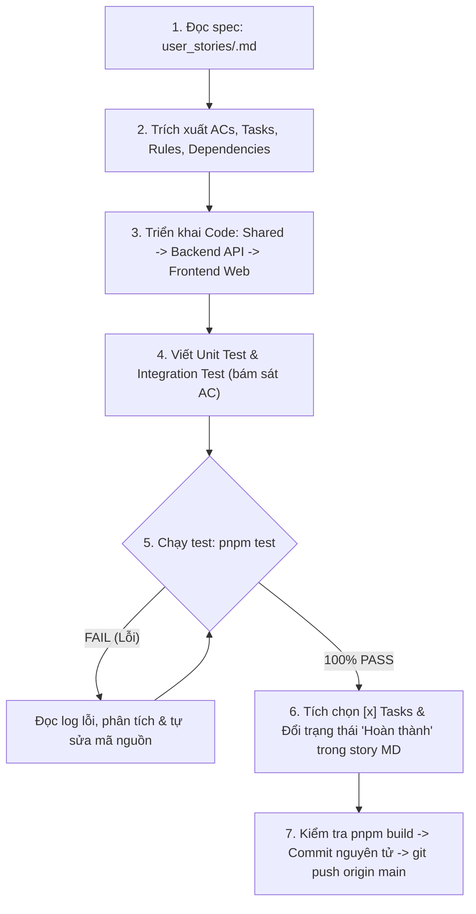

# ĐỊA CHÍNH SỐ - QUY CHUẨN VẬN HÀNH AGENT (AGENTS.md)

> Tài liệu quy chuẩn kỹ thuật vĩnh viễn dành cho AI Coding Assistant (Antigravity) khi làm việc trên dự án **Địa Chính Số (Sổ Đỏ Số & CSDL Thửa Đất Thời Gian Thực)**.

---

## 1. Nguyên Tắc Cốt Lõi (Core Principles)

1. **Tuân thủ Pháp lý & Thực tế**: Mọi chức năng, thuật ngữ và luồng dữ liệu phải bám sát **Luật Đất đai 2024 (số 31/2024/QH15)**, Đề án 06, hệ quy chiếu quốc gia **VN-2000**, và cơ chế **Khóa giao dịch thời gian thực (Real-time Transaction Lock)**.
2. **Nguồn Sự Thật Duy Nhất (Single Source of Truth)**:
   - Toàn bộ 114 User Stories được số hóa trong thư mục `user_stories/` (`user_stories/DCS-XX-YY-ZZZ.md`).
   - Danh mục API Endpoints được chuẩn hóa tại `docs/api-endpoints.md`.
   - Danh mục tổng quan các Story được lập chỉ mục tại `user_stories/README.md`.
3. **Chính sách Kiểm thử Nghiêm ngặt (Strict TDD / Test-Verified Policy)**:
   - **MỌI** User Story khi triển khai **BẮT BUỘC** phải có **Unit Test** và **Integration Test** đi kèm.
   - Các kịch bản kiểm thử phải ánh xạ trực tiếp và bao phủ đầy đủ các **Tiêu chí chấp nhận (Acceptance Criteria)** trong file story.
4. **Quy tắc Vòng lặp Tự sửa lỗi (Self-Correction Loop)**:
   - Sau khi viết code và test, Agent chạy lệnh test tương ứng (`pnpm test` hoặc `pnpm --filter @diachinhso/api test`).
   - Nếu test fail: Đọc kỹ stack trace, xác định nguyên nhân gốc rễ, sửa đổi mã nguồn hoặc kịch bản test, chạy lại cho đến khi **100% test case PASS**.
   - **TUYỆT ĐỐI KHÔNG** commit hay push mã nguồn đang gãy test, không được dùng `test.skip` hoặc giả lập kết quả giả tạo.
5. **Chiến lược Commit Nguyên tử (Atomic Commits) & Push**:
   - Chia nhỏ commit theo từng thành phần: `feat(shared)`, `feat(api)`, `test(api)`, `feat(web)`, `docs(story)`.
   - Chạy `pnpm build` kiểm tra toàn bộ Monorepo.
   - Chỉ push (`git push origin main`) sau khi toàn bộ tests và build đều pass.

---

## 2. Quy Trình Tự Động Hóa Thực Thi User Story (Story-Driven Workflow)

Khi người dùng gửi yêu cầu chứa **Mã User Story** (ví dụ: `DCS-01-CN-001`, `DCS-03-CN-001`) hoặc **Tên User Story** (ví dụ: `Đăng nhập Cổng Định danh Số`, `Khóa phiên giao dịch`), Agent lập tức kích hoạt quy trình tự động 7 bước sau:



### Bước 1: Tra cứu & Đọc Đặc Tả Story
- Tìm file Markdown tại `user_stories/<STORY_ID>.md`.
- Đọc kỹ 4 phần:
  1. Persona & Mục tiêu nghiệp vụ.
  2. 4 Tiêu chí chấp nhận (Given - When - Then).
  3. 5 Tasks kỹ thuật cần đạt.
  4. Quy tắc nghiệp vụ liên quan (QTD-xx).

### Bước 2: Triển khai Mã Nguồn (Code Implementation)
Tuân thủ thứ tự phân tầng phụ thuộc:
1. **`packages/shared`**: Khai báo enums, interfaces, Zod schemas, constants. Chạy `pnpm --filter @diachinhso/shared build`.
2. **`apps/api`**:
   - Drizzle ORM schema / migration nếu có thay đổi bảng.
   - Service nghiệp vụ, xử lý ACID transaction, Redis lock/cache.
   - Controller kèm Swagger annotations, validation pipe, guards.
3. **`apps/web`**:
   - Xây dựng UI page/component trong `src/app/` và `src/components/`.
   - Kết nối API Backend, kiểm soát trạng thái giao diện và phản hồi người dùng.

### Bước 3: Viết Bộ Kiểm Thử (Unit & Integration Tests)
- **Vị trí file test**: Đặt cạnh file cần test với hậu tố `.spec.ts` (ví dụ: `spatial.service.spec.ts`, `lock.service.spec.ts`).
- **Phạm vi Unit Test**: Kiểm thử logic nghiệp vụ độc lập, validation, xử lý dữ liệu sai định dạng (AC-02), quy tắc ràng buộc (AC-03).
- **Phạm vi Integration Test**: Kiểm thử controller API với NestJS Testing Module, mô phỏng phản hồi HTTP (200, 400, 409, 403, 404).

### Bước 4: Thực thi Kiểm thử & Vòng lặp Sửa lỗi
- Chạy lệnh: `pnpm --filter @diachinhso/api test`
- Phân tích output:
  - Nếu xuất hiện lỗi đỏ: Phân tích log lỗi chi tiết, sửa code/test ngay lập tức.
  - Lặp lại lệnh test cho đến khi terminal báo xanh: `Test Suites: X passed, X total. Tests: Y passed, Y total.`

### Bước 5: Cập Nhật Tài Liệu Story & Danh Mục
- Mở file `user_stories/<STORY_ID>.md`:
  - Đổi `- [ ]` thành `- [x]` cho các task đã hoàn thành.
  - Đổi `- **Trạng thái**: Chưa thực hiện` thành `- **Trạng thái**: Hoàn thành`.
- Nếu có endpoint mới được tạo, cập nhật vào file `docs/api-endpoints.md`.

### Bước 6: Kiểm tra Biên dịch Monorepo (Build Gate)
- Chạy: `pnpm build`
- Xác nhận cả 3 projects (`@diachinhso/shared`, `@diachinhso/api`, `@diachinhso/web`) đều compile thành công không có cảnh báo hoặc lỗi TypeScript.

### Bước 7: Commit Từng Phần & Đẩy Mã Nguồn
- Commit các thay đổi theo chuẩn Conventional Commits:
  ```bash
  git add packages/shared/ ; git commit -m "feat(shared): add types and schemas for <STORY_ID>"
  git add apps/api/ ; git commit -m "feat(api): implement service and controller for <STORY_ID>"
  git add apps/api/src/**/*.spec.ts ; git commit -m "test(api): unit and integration tests for <STORY_ID>"
  git add apps/web/ ; git commit -m "feat(web): add UI interface for <STORY_ID>"
  git add user_stories/ docs/ ; git commit -m "docs(story): mark <STORY_ID> as completed"
  ```
- Push lên repository: `git push origin main`.
- Tổng kết ngắn gọn cho người dùng: Các file đã tạo/sửa, kết quả test pass, commit IDs.

---

## 3. Quy Ước Công Nghệ & Đường Dẫn Thư Mục

- **Backend**: NestJS 10, TypeScript, Drizzle ORM, PostgreSQL 16 + PostGIS 3.4, IORedis.
- **Frontend**: Next.js 15 (App Router, React 19), Tailwind CSS, Lucide React, MapLibre GL JS.
- **Shared Package**: `@diachinhso/shared` (`packages/shared/src/index.ts`).
- **Hệ quy chiếu GIS**: VN-2000 (kinh tuyến trục 105°00', múi chiếu 3 độ, SRID 3405/9210) chuyển đổi WGS84 (SRID 4326) để hiển thị web.
- **Cơ chế Khóa**: Redis Redlock 90 phút (Key prefix: `diachinhso:lock:parcel:<id>`).
- **Cổng Định Danh**: Mock Sandbox Citizen IdP (CCCD 12 số + OTP) không phụ thuộc mạng thật C06 VNeID.
