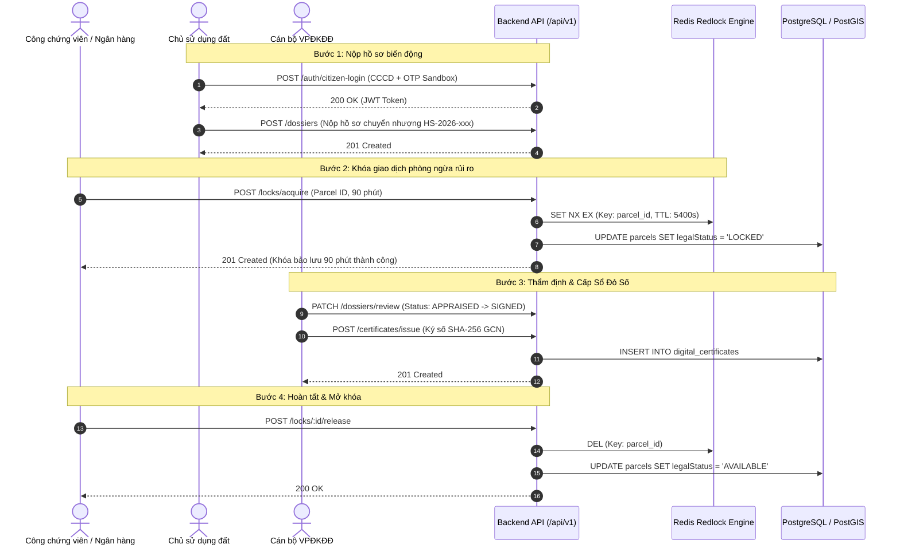

# Tài Liệu Danh Sách API Endpoints - Hệ Thống Địa Chính Số

> Tài liệu đặc tả kỹ thuật chi tiết các điểm cuối API (RESTful API Endpoints) phục vụ nền tảng **Địa Chính Số (Sổ Đỏ Số & CSDL Thửa Đất Thời Gian Thực)** theo quy chuẩn Luật Đất đai 2024.

---

## 1. Tiêu Chuẩn & Quy Ước Chung (API Standards)

- **Giao thức**: HTTP/1.1 & HTTP/2 trên SSL/TLS.
- **Tiền tố đường dẫn (Base URL)**: `http://localhost:4000/api/v1` (hoặc domain Production).
- **Tài liệu OpenAPI / Swagger UI**: `http://localhost:4000/api/docs`.
- **Cơ chế xác thực**: `Authorization: Bearer <JWT_ACCESS_TOKEN>`.
- **Định dạng dữ liệu**: `Content-Type: application/json; charset=utf-8`.
- **Cấu trúc phản hồi chuẩn**:
  ```json
  {
    "statusCode": 200,
    "message": "Thành công",
    "data": { ... },
    "timestamp": "2026-10-19T08:00:00.000Z"
  }
  ```
- **Xử lý mã lỗi chuẩn HTTP**:
  - `400 Bad Request`: Dữ liệu đầu vào sai định dạng (Zod/ValidationPipe).
  - `401 Unauthorized`: Token không hợp lệ hoặc đã hết hạn.
  - `403 Forbidden`: Tài khoản không đủ quyền hạn vai trò (RolesGuard).
  - `404 Not Found`: Không tìm thấy tài nguyên (Thửa đất, Hồ sơ, GCN).
  - `409 Conflict`: Xung đột phiên khóa giao dịch hoặc trùng lặp mã định danh.
  - `500 Internal Server Error`: Lỗi xử lý nội bộ phía máy chủ.

---

## 2. Nhóm API Xác Thực & Định Danh (Auth & Citizen IdP)
**Prefix**: `/api/v1/auth` | **Tags**: `Xác thực & Danh tính (Auth & IdP)`

### 2.1. Đăng nhập Công dân qua CCCD Sandbox (Thay thế VNeID trong môi trường dev)
- **Method**: `POST`
- **Path**: `/api/v1/auth/citizen-login`
- **Quyền truy cập**: Public (Chủ sử dụng đất)
- **Request Body**:
  ```json
  {
    "citizenId": "001090012345",
    "fullName": "Nguyễn Văn An",
    "phoneNumber": "0912345678",
    "otpCode": "123456"
  }
  ```
- **Response `200 OK`**:
  ```json
  {
    "accessToken": "eyJhbGciOiJIUzI1NiIsIn...",
    "user": {
      "id": "b3e0c0a1-4321-4f9a-8b1e-7f6a5b4c3d2e",
      "citizenId": "001090012345",
      "fullName": "Nguyễn Văn An",
      "role": "LAND_USER"
    }
  }
  ```

### 2.2. Đăng nhập Cán bộ nghiệp vụ liên ngành (SSO / Internal Login)
- **Method**: `POST`
- **Path**: `/api/v1/auth/officer-login`
- **Quyền truy cập**: Public (Cán bộ địa chính, VPĐKĐĐ, Công chứng, Ngân hàng, Thanh tra, Admin)
- **Request Body**:
  ```json
  {
    "username": "canbo_diachinh",
    "password": "Password@2026",
    "role": "COMMUNE_OFFICER"
  }
  ```
- **Response `200 OK`**:
  ```json
  {
    "accessToken": "eyJhbGciOiJIUzI1NiIsIn...",
    "user": {
      "id": "c1f2e3d4-5678-90ab-cdef-1234567890ab",
      "username": "canbo_diachinh",
      "fullName": "Cán bộ NGUYỄN VĂN ĐẠT",
      "role": "COMMUNE_OFFICER",
      "department": "UBND Phường Cống Vị, Ba Đình, Hà Nội"
    }
  }
  ```

### 2.3. Lấy thông tin tài khoản hiện hành từ JWT Token
- **Method**: `GET`
- **Path**: `/api/v1/auth/me`
- **Headers**: `Authorization: Bearer <TOKEN>`
- **Response `200 OK`**: Thông tin người dùng kèm vai trò và thẩm quyền đơn vị.

---

## 3. Nhóm API Quản Lý Thửa Đất (Cadastral Parcels)
**Prefix**: `/api/v1/parcels` | **Tags**: `Quản lý Thửa đất & Bản đồ số (Parcels)`

### 3.1. Lấy danh sách thửa đất (kèm phân trang & bộ lọc)
- **Method**: `GET`
- **Path**: `/api/v1/parcels`
- **Query Params**:
  - `communeId` (tùy chọn): Mã xã/phường (VD: `HN-BA-DINH`)
  - `status` (tùy chọn): `AVAILABLE` | `LOCKED` | `MORTGAGED` | `DISPUTED` | `FROZEN`
- **Response `200 OK`**: Mảng danh sách các thửa đất kèm thông tin ranh giới GeoJSON.

### 3.2. Tra cứu chi tiết thửa đất theo ID
- **Method**: `GET`
- **Path**: `/api/v1/parcels/:id`
- **Response `200 OK`**:
  ```json
  {
    "id": "e6a7c3b2-1234-4567-89ab-cdef01234567",
    "nationalCode": "HN-BA-DINH.012.0045",
    "communeId": "HN-BA-DINH",
    "sheetNumber": 12,
    "parcelNumber": 45,
    "area": 125.6,
    "purposeCode": "ODT",
    "address": "Số 18 Phố Liễu Giai, Phường Cống Vị, Quận Ba Đình, Hà Nội",
    "legalStatus": "AVAILABLE",
    "verticesVN2000": [
      { "pointIndex": 1, "x": 2321450.2, "y": 504210.5 },
      { "pointIndex": 2, "x": 2321462.8, "y": 504225.1 },
      { "pointIndex": 3, "x": 2321448.0, "y": 504238.6 },
      { "pointIndex": 4, "x": 2321435.4, "y": 504224.0 }
    ],
    "boundaryGeojson": {
      "type": "Polygon",
      "coordinates": [[[105.8421, 21.0345], [105.8423, 21.0346], ...]]
    }
  }
  ```

### 3.3. Tra cứu thửa đất theo Mã định danh quốc gia (15 ký tự)
- **Method**: `GET`
- **Path**: `/api/v1/parcels/by-code/:nationalCode`
- **Example**: `/api/v1/parcels/by-code/HN-BA-DINH.012.0045`

### 3.4. Đăng ký mới thửa đất
- **Method**: `POST`
- **Path**: `/api/v1/parcels`
- **Yêu cầu quyền**: `COMMUNE_OFFICER`, `LAND_REGISTRAR`, `ADMIN`
- **Request Body**:
  ```json
  {
    "communeId": "HN-BA-DINH",
    "sheetNumber": 12,
    "parcelNumber": 48,
    "area": 95.5,
    "purposeCode": "ODT",
    "address": "Số 24 Phố Liễu Giai, Phường Cống Vị, Ba Đình, Hà Nội",
    "verticesVN2000": [
      { "pointIndex": 1, "x": 2321495.2, "y": 504260.0 },
      { "pointIndex": 2, "x": 2321510.5, "y": 504275.2 },
      { "pointIndex": 3, "x": 2321498.0, "y": 504288.1 },
      { "pointIndex": 4, "x": 2321478.1, "y": 504275.4 }
    ],
    "ownerIds": ["b3e0c0a1-4321-4f9a-8b1e-7f6a5b4c3d2e"]
  }
  ```

### 3.5. Cập nhật trạng thái pháp lý thửa đất
- **Method**: `PATCH`
- **Path**: `/api/v1/parcels/:id/status`
- **Yêu cầu quyền**: `COMMUNE_OFFICER`, `LAND_REGISTRAR`, `NOTARY_BANK`, `ADMIN`
- **Request Body**: `{ "status": "LOCKED" | "MORTGAGED" | "DISPUTED" | "AVAILABLE" }`

---

## 4. Nhóm API Khóa Giao Dịch Thời Gian Thực (Transaction Lock Engine)
**Prefix**: `/api/v1/locks` | **Tags**: `Khóa Giao dịch Thời gian thực (Real-time Transaction Lock)`

> **Nguyên lý hoạt động**: Áp dụng thuật toán Distributed Lock với Redis Atomic `SET NX EX` (TTL 90 phút). Khi một tổ chức công chứng hoặc chi nhánh ngân hàng kích hoạt khóa phiên, toàn bộ hệ thống lập tức từ chối mọi nỗ lực giao dịch/thế chấp khác đối với thửa đất này.

### 4.1. Kích hoạt khóa giao dịch thửa đất (Acquire Lock)
- **Method**: `POST`
- **Path**: `/api/v1/locks/acquire`
- **Yêu cầu quyền**: `NOTARY_BANK`, `LAND_REGISTRAR`, `ADMIN`
- **Request Body**:
  ```json
  {
    "parcelId": "e6a7c3b2-1234-4567-89ab-cdef01234567",
    "organizationName": "Văn phòng Công chứng Thăng Long",
    "durationMinutes": 90
  }
  ```
- **Response `201 Created`**:
  ```json
  {
    "id": "7a8b9c0d-1e2f-3a4b-5c6d-7e8f9a0b1c2d",
    "parcelId": "e6a7c3b2-1234-4567-89ab-cdef01234567",
    "nationalCode": "HN-BA-DINH.012.0045",
    "organizationName": "Văn phòng Công chứng Thăng Long",
    "sessionToken": "4fa83f21-7294-4d89-9e81-01f28b48c901",
    "status": "ACTIVE",
    "lockedAt": "2026-10-19T08:15:00.000Z",
    "expiresAt": "2026-10-19T09:45:00.000Z",
    "durationMinutes": 90
  }
  ```
- **Error Response `409 Conflict`**:
  ```json
  {
    "statusCode": 409,
    "message": "Thửa đất đang bị khóa bởi Ngân hàng TMCP Ngoại thương Việt Nam. Phiên khóa còn hiệu lực."
  }
  ```

### 4.2. Mở khóa phiên giao dịch (Release Lock)
- **Method**: `POST`
- **Path**: `/api/v1/locks/:lockId/release`
- **Yêu cầu quyền**: `NOTARY_BANK`, `LAND_REGISTRAR`, `ADMIN`
- **Response `200 OK`**: Phiên khóa được chuyển sang `RELEASED`, thửa đất được hoàn nguyên về `AVAILABLE`.

### 4.3. Tra cứu phiên khóa đang hoạt động của thửa đất
- **Method**: `GET`
- **Path**: `/api/v1/locks/parcel/:parcelId`
- **Response `200 OK`**: Trả về chi tiết phiên khóa nếu đang tồn tại, hoặc `null` nếu thửa đất đang mở tự do.

---

## 5. Nhóm API Sổ Đỏ Số & Giấy Chứng Nhận Điện Tử (Certificates)
**Prefix**: `/api/v1/certificates` | **Tags**: `Sổ Đỏ Số & Giấy Chứng Nhận Điện Tử (Certificates)`

### 5.1. Ký số phát hành Sổ Đỏ Số điện tử
- **Method**: `POST`
- **Path**: `/api/v1/certificates/issue`
- **Yêu cầu quyền**: `LAND_REGISTRAR`, `ADMIN`
- **Request Body**:
  ```json
  {
    "parcelId": "e6a7c3b2-1234-4567-89ab-cdef01234567",
    "certificateNumber": "CS 892104",
    "serialNumber": "SR-2026-0045",
    "signerName": "Nguyễn Văn Đạt",
    "signerTitle": "Giám đốc Văn phòng Đăng ký Đất đai",
    "pdfUrl": "https://s3.diachinhso.gov.vn/certificates/CS892104.pdf"
  }
  ```
- **Response `201 Created`**: Tạo GCN điện tử kèm mã băm SHA-256 động và chữ ký số PAdES.

### 5.2. Quét mã QR & Đối soát tính toàn vẹn Sổ Đỏ Số
- **Method**: `GET`
- **Path**: `/api/v1/certificates/verify/:qrHash`
- **Quyền truy cập**: Public (Công dân, Công chứng viên, Cán bộ Tín dụng)
- **Response `200 OK` (Hợp pháp)**:
  ```json
  {
    "isValid": true,
    "message": "Giấy chứng nhận quyền sử dụng đất số hợp pháp, được xác thực chữ ký điện tử từ cơ sở dữ liệu quốc gia.",
    "certificate": { ... },
    "parcel": { ... }
  }
  ```
- **Response `200 OK` (Giả mạo / Không hợp lệ)**:
  ```json
  {
    "isValid": false,
    "message": "CẢNH BÁO: Giấy chứng nhận không tồn tại trên hệ thống hoặc có dấu hiệu làm giả!"
  }
  ```

### 5.3. Xem thông tin Giấy chứng nhận của một thửa đất
- **Method**: `GET`
- **Path**: `/api/v1/certificates/parcel/:parcelId`

---

## 6. Nhóm API Dịch Vụ Công & Biến Động Đất Đai (Dossiers)
**Prefix**: `/api/v1/dossiers` | **Tags**: `Dịch vụ công & Hồ sơ Biến động Đất đai (Dossiers)`

### 6.1. Nộp hồ sơ biến động đất đai trực tuyến
- **Method**: `POST`
- **Path**: `/api/v1/dossiers`
- **Yêu cầu quyền**: `LAND_USER`, `ADMIN`
- **Request Body**:
  ```json
  {
    "parcelId": "e6a7c3b2-1234-4567-89ab-cdef01234567",
    "fluctuationType": "TRANSFER",
    "applicantName": "Nguyễn Văn An",
    "applicantCitizenId": "001090012345",
    "applicantPhone": "0912345678",
    "documentUrls": [
      "https://s3.diachinhso.gov.vn/dossiers/hopdong_chuyennhuong.pdf",
      "https://s3.diachinhso.gov.vn/dossiers/ban_scan_sodo.pdf"
    ],
    "notes": "Hồ sơ chuyển nhượng toàn bộ quyền sử dụng thửa đất số 45 tờ 12."
  }
  ```
- **Response `201 Created`**: Sinh mã hồ sơ chuẩn quốc gia (VD: `HS-2026-784192`).

### 6.2. Lấy danh sách hồ sơ dịch vụ công
- **Method**: `GET`
- **Path**: `/api/v1/dossiers`

### 6.3. Tra cứu chi tiết tiến độ xử lý hồ sơ
- **Method**: `GET`
- **Path**: `/api/v1/dossiers/:id`

### 6.4. Thẩm định / Cập nhật tiến trình hồ sơ (Cán bộ xã & VPĐKĐĐ)
- **Method**: `PATCH`
- **Path**: `/api/v1/dossiers/review`
- **Yêu cầu quyền**: `COMMUNE_OFFICER`, `LAND_REGISTRAR`, `ADMIN`
- **Request Body**:
  ```json
  {
    "dossierId": "d8e7f6a5-4321-0987-ba98-fedcba098765",
    "status": "COMMUNE_VERIFIED",
    "comments": "Đã tiến hành đo đạc xác minh mốc giới hiện trạng tại thực địa, ranh giới không có tranh chấp khiếu nại."
  }
  ```

---

## 7. Nhóm API Bản Đồ Số & Không Gian GIS (Spatial GIS)
**Prefix**: `/api/v1/spatial` | **Tags**: `Bản đồ số & Không gian GIS (Spatial GIS)`

### 7.1. Chuyển đổi đỉnh ranh giới VN-2000 sang GeoJSON Polygon WGS84
- **Method**: `POST`
- **Path**: `/api/v1/spatial/transform-vn2000`
- **Request Body**:
  ```json
  {
    "vertices": [
      { "pointIndex": 1, "x": 2321450.2, "y": 504210.5 },
      { "pointIndex": 2, "x": 2321462.8, "y": 504225.1 },
      { "pointIndex": 3, "x": 2321448.0, "y": 504238.6 },
      { "pointIndex": 4, "x": 2321435.4, "y": 504224.0 }
    ],
    "srid": 3405
  }
  ```
- **Response `200 OK`**: Polygon Feature WGS84 (EPSG:4326) để vẽ trực tiếp trên MapLibre GL.

### 7.2. Kiểm tra chồng lấn quy hoạch không gian xây dựng
- **Method**: `POST`
- **Path**: `/api/v1/spatial/check-zoning`
- **Response `200 OK`**: Thông tin phân khu quy hoạch, giới hạn tầng cao, mật độ xây dựng.

---

## 8. Sơ Đồ Quy Trình Tương Tác Giữa Các Endpoints


