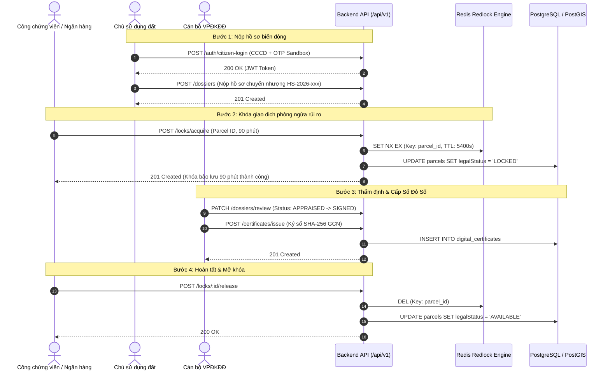

# Tài Liệu Danh Sách API Endpoints - Hệ Thống Địa Chính Số

> Tài liệu đặc tả kỹ thuật chi tiết các điểm cuối API (RESTful API Endpoints) phục vụ nền tảng **Địa Chính Số (Sổ Đỏ Số & CSDL Thửa Đất Thời Gian Thực)** theo quy chuẩn Luật Đất đai 2024.

---

## 1. Tiêu Chuẩn & Quy Ước Chung (API Standards)

- **Giao thức**: HTTP/1.1 & HTTP/2 trên SSL/TLS.
- **Tiền tố đường dẫn (Base URL)**: `http://localhost:4000/api/v1` (hoặc domain Production).
- **Tài liệu OpenAPI / Swagger UI**: `http://localhost:4000/api/docs`.
- **Cơ chế xác thực**: `Authorization: Bearer <JWT_ACCESS_TOKEN>`.
- **Định dạng dữ liệu**: `Content-Type: application/json; charset=utf-8`.
- **Cấu trúc phản hồi chuẩn**:
  ```json
  {
    "statusCode": 200,
    "message": "Thành công",
    "data": { ... },
    "timestamp": "2026-10-19T08:00:00.000Z"
  }
  ```
- **Xử lý mã lỗi chuẩn HTTP**:
  - `400 Bad Request`: Dữ liệu đầu vào sai định dạng (Zod/ValidationPipe).
  - `401 Unauthorized`: Token không hợp lệ hoặc đã hết hạn.
  - `403 Forbidden`: Tài khoản không đủ quyền hạn vai trò (RolesGuard).
  - `404 Not Found`: Không tìm thấy tài nguyên (Thửa đất, Hồ sơ, GCN).
  - `409 Conflict`: Xung đột phiên khóa giao dịch hoặc trùng lặp mã định danh.
  - `500 Internal Server Error`: Lỗi xử lý nội bộ phía máy chủ.

---

## 2. Nhóm API Xác Thực & Định Danh (Auth & Citizen IdP)
**Prefix**: `/api/v1/auth` | **Tags**: `Xác thực & Danh tính (Auth & IdP)`
### [DCS-01-CN-001] Gửi mã xác thực OTP SMS đến số điện thoại công dân (Sandbox & Prod)
- **Method**: `POST`
- **Path**: `/api/v1/auth/citizen/send-otp`
- **Quyền hạn vai trò**: Public (Chủ sử dụng đất / Người dân)
- **Request Body**:
  ```json
  {
    "citizenId": "001090012345",
    "phoneNumber": "0912345678",
    "fullName": "Nguyễn Văn An"
  }
  ```
- **Response `200 OK`**:
  ```json
  {
    "success": true,
    "message": "Mã xác thực OTP gồm 6 chữ số đã được gửi thành công đến số điện thoại 091****678.",
    "expiresInSeconds": 300,
    "mockOtp": "123456"
  }
  ```
- **Mã lỗi đặc thù**:
  - `400 Bad Request`: Số CCCD không đúng 12 chữ số hoặc số điện thoại không hợp lệ.
  - `403 Forbidden`: Tài khoản công dân đang bị tạm khóa hoặc vi phạm quy tắc thẩm quyền địa giới theo QTD-07.

### [DCS-01-CN-001] Xác thực OTP SMS và đăng nhập Cổng Định danh Số Công dân
- **Method**: `POST`
- **Path**: `/api/v1/auth/citizen/verify-otp`
- **Quyền hạn vai trò**: Public (Chủ sử dụng đất)
- **Request Body**:
  ```json
  {
    "citizenId": "001090012345",
    "phoneNumber": "0912345678",
    "otpCode": "123456"
  }
  ```
- **Response `200 OK`**:
  ```json
  {
    "accessToken": "eyJhbGciOiJIUzI1NiIsInR5cCI6IkpXVCJ9...",
    "user": {
      "id": "b3e0c0a1-4321-4f9a-8b1e-7f6a5b4c3d2e",
      "citizenId": "001090012345",
      "fullName": "Nguyễn Văn An",
      "phoneNumber": "0912345678",
      "role": "LAND_USER"
    },
    "auditHash": "a8f9c0e2b1d345f67890abcdef1234567890abcdef1234567890abcdef123456",
    "walletSummary": {
      "parcelCount": 1,
      "certificateCount": 1
    }
  }
  ```
- **Mã lỗi đặc thù**:
  - `400 Bad Request`: Mã OTP sai, mã OTP đã hết hạn hoặc chưa được gửi yêu cầu.
  - `403 Forbidden`: Tài khoản công dân bị tạm khóa theo quy tắc QTD-07.

### [DCS-01-CN-001] Tra cứu Ví Sổ Đỏ Số của Công dân
- **Method**: `GET`
- **Path**: `/api/v1/auth/wallet`
- **Quyền hạn vai trò**: `LAND_USER`, `ADMIN` (Bearer Token)
- **Response `200 OK`**:
  ```json
  {
    "user": {
      "id": "b3e0c0a1-4321-4f9a-8b1e-7f6a5b4c3d2e",
      "citizenId": "001090012345",
      "fullName": "Nguyễn Văn An",
      "role": "LAND_USER",
      "phoneNumber": "0912345678"
    },
    "walletSummary": {
      "parcels": [
        {
          "nationalCode": "HN-BA-DINH.012.0045",
          "sheetNumber": 12,
          "parcelNumber": 45,
          "area": 125.6,
          "address": "Số 18 Phố Liễu Giai, Phường Cống Vị, Quận Ba Đình, Hà Nội",
          "certificateNumber": "CS 123456",
          "status": "AVAILABLE"
        }
      ]
    }
  }
  ```

### [DCS-01-CN-002] Đăng nhập SSO tài khoản công vụ cho cán bộ ngành kèm MFA
- **Method**: `POST`
- **Path**: `/api/v1/auth/officer/sso-login`
- **Quyền hạn vai trò**: Public / Cán bộ ngành (`COMMUNE_OFFICER`, `LAND_REGISTRAR`, `NOTARY_BANK`, `INSPECTOR`, `ADMIN`)
- **Request Body**:
  ```json
  {
    "username": "canbo.convi@diachinh.gov.vn",
    "password": "SecurePassword2026!",
    "mfaCode": "123456",
    "role": "COMMUNE_OFFICER",
    "administrativeUnitCode": "XA_CONG_VI"
  }
  ```
- **Response `200 OK`**:
  ```json
  {
    "accessToken": "eyJhbGciOiJIUzI1NiIsInR5cCI6IkpXVCJ9...",
    "user": {
      "id": "officer-uuid-002",
      "username": "canbo.convi@diachinh.gov.vn",
      "fullName": "Nguyễn Văn Bình",
      "role": "COMMUNE_OFFICER",
      "department": "Phường Cống Vị, Ba Đình, Hà Nội",
      "administrativeUnitCode": "XA_CONG_VI",
      "administrativeUnitName": "Phường Cống Vị, Quận Ba Đình, Hà Nội"
    },
    "auditHash": "e3b0c44298fc1c149afbf4c8996fb92427ae41e4649b934ca495991b7852b855",
    "sessionExpiry": "2026-10-21T18:00:00.000Z"
  }
  ```
- **Mã lỗi đặc thù**:
  - `400 Bad Request`: Dữ liệu đầu vào không hợp lệ hoặc mã MFA không đúng 6 số.
  - `401 Unauthorized`: Mã xác thực MFA không chính xác hoặc đã hết hạn.
  - `403 Forbidden`: Tài khoản bị tạm khóa, vi phạm thẩm quyền địa giới hành chính (QTD-16) hoặc phát hiện địa chỉ IP bất thường ngoài mạng công vụ (QTD-22).

### [DCS-01-CN-003] Lấy danh mục phân cấp địa giới hành chính mô hình 2 cấp (34 Tỉnh thành & Xã/Phường)
- **Method**: `GET`
- **Path**: `/api/v1/jurisdiction/hierarchy`
- **Quyền hạn vai trò**: Tất cả người dùng và cán bộ hệ thống
- **Response `200 OK`**:
  ```json
  {
    "totalUnits": 14,
    "provinces": [
      {
        "code": "TINH_HN",
        "name": "Thành phố Hà Nội",
        "level": "PROVINCE",
        "districts": [
          {
            "code": "HUYEN_BD",
            "name": "Quận Ba Đình",
            "level": "DISTRICT",
            "parentCode": "TINH_HN",
            "communes": [
              {
                "code": "XA_CONG_VI",
                "name": "Phường Cống Vị",
                "level": "COMMUNE",
                "parentCode": "HUYEN_BD"
              }
            ]
          }
        ]
      }
    ]
  }
  ```

### [DCS-01-CN-003] Cấu hình ma trận phân quyền RBAC mô hình 2 cấp tinh gọn
- **Method**: `POST`
- **Path**: `/api/v1/jurisdiction/matrix`
- **Quyền hạn vai trò**: `ADMIN` (Quản trị viên Hệ thống)
- **Request Body**:
  ```json
  {
    "role": "LAND_REGISTRAR",
    "level": "DISTRICT",
    "unitCode": "HUYEN_BD",
    "allowedActions": ["READ", "CREATE", "UPDATE", "APPROVE"],
    "description": "Văn phòng Đăng ký Đất đai Ba Đình"
  }
  ```
- **Response `200 OK`**:
  ```json
  {
    "success": true,
    "message": "Cấu hình ma trận phân quyền cấp hành chính thành công",
    "policy": {
      "id": "pol-1729500000000",
      "role": "LAND_REGISTRAR",
      "level": "DISTRICT",
      "unitCode": "HUYEN_BD",
      "unitName": "Quận Ba Đình",
      "allowedActions": ["READ", "CREATE", "UPDATE", "APPROVE"],
      "description": "Văn phòng Đăng ký Đất đai Ba Đình",
      "updatedAt": "2026-10-21T10:30:00.000Z"
    },
    "auditHash": "7f83b1657ff1fc53b92dc18148a1d65dfc2d4b1fa3d677284addd200126d9069"
  }
  ```
- **Mã lỗi đặc thù**:
  - `400 Bad Request`: Thiếu trường bắt buộc, danh sách quyền rỗng, hoặc mã đơn vị hành chính không tồn tại trong danh mục 3 cấp.
  - `403 Forbidden`: Người dùng không có quyền quản trị viên.

### [DCS-01-CN-003] Đánh giá thẩm quyền truy cập dữ liệu địa chính theo mô hình 2 cấp (QTD-16)
- **Method**: `POST`
- **Path**: `/api/v1/jurisdiction/evaluate`
- **Quyền hạn vai trò**: Tất cả vai trò nghiệp vụ
- **Request Body**:
  ```json
  {
    "userRole": "COMMUNE_OFFICER",
    "userUnitCode": "XA_CONG_VI",
    "action": "READ",
    "targetUnitCode": "XA_CONG_VI"
  }
  ```
- **Response `200 OK` (Thành công - Trong thẩm quyền địa giới)**:
  ```json
  {
    "granted": true,
    "reason": "Thao tác hợp lệ trong phạm vi thẩm quyền địa giới hành chính được phân công (Phường Cống Vị -> Phường Cống Vị)",
    "userLevel": "COMMUNE",
    "targetLevel": "COMMUNE",
    "auditHash": "e3b0c44298fc1c149afbf4c8996fb92427ae41e4649b934ca495991b7852b855"
  }
  ```
- **Mã lỗi đặc thù**:
  - `400 Bad Request`: Mã đơn vị hành chính người dùng hoặc mục tiêu không tồn tại.
  - `403 Forbidden`: Vượt quyền địa giới hành chính theo quy định phân cấp quản lý (QTD-16). Ví dụ cán bộ xã Phường Cống Vị cố thao tác lên dữ liệu của Phường Liễu Giai hoặc Quận Hoàn Kiếm.

### 2.2. Đăng nhập Cán bộ nghiệp vụ liên ngành (SSO / Internal Login)
- **Method**: `POST`
- **Path**: `/api/v1/auth/officer-login`
- **Quyền truy cập**: Public (Cán bộ địa chính, VPĐKĐĐ, Công chứng, Ngân hàng, Thanh tra, Admin)
- **Request Body**:
  ```json
  {
    "username": "canbo_diachinh",
    "password": "Password@2026",
    "role": "COMMUNE_OFFICER"
  }
  ```
- **Response `200 OK`**:
  ```json
  {
    "accessToken": "eyJhbGciOiJIUzI1NiIsIn...",
    "user": {
      "id": "c1f2e3d4-5678-90ab-cdef-1234567890ab",
      "username": "canbo_diachinh",
      "fullName": "Cán bộ NGUYỄN VĂN ĐẠT",
      "role": "COMMUNE_OFFICER",
      "department": "UBND Phường Cống Vị, Ba Đình, Hà Nội"
    }
  }
  ```

### 2.3. Lấy thông tin tài khoản hiện hành từ JWT Token
- **Method**: `GET`
- **Path**: `/api/v1/auth/me`
- **Headers**: `Authorization: Bearer <TOKEN>`
- **Response `200 OK`**: Thông tin người dùng kèm vai trò và thẩm quyền đơn vị.

---

## 3. Nhóm API Quản Lý Thửa Đất (Cadastral Parcels)
**Prefix**: `/api/v1/parcels` | **Tags**: `Quản lý Thửa đất & Bản đồ số (Parcels)`

### 3.1. Lấy danh sách thửa đất (kèm phân trang & bộ lọc)
- **Method**: `GET`
- **Path**: `/api/v1/parcels`
- **Query Params**:
  - `communeId` (tùy chọn): Mã xã/phường (VD: `HN-BA-DINH`)
  - `status` (tùy chọn): `AVAILABLE` | `LOCKED` | `MORTGAGED` | `DISPUTED` | `FROZEN`
- **Response `200 OK`**: Mảng danh sách các thửa đất kèm thông tin ranh giới GeoJSON.

### 3.2. Tra cứu chi tiết thửa đất theo ID
- **Method**: `GET`
- **Path**: `/api/v1/parcels/:id`
- **Response `200 OK`**:
  ```json
  {
    "id": "e6a7c3b2-1234-4567-89ab-cdef01234567",
    "nationalCode": "HN-BA-DINH.012.0045",
    "communeId": "HN-BA-DINH",
    "sheetNumber": 12,
    "parcelNumber": 45,
    "area": 125.6,
    "purposeCode": "ODT",
    "address": "Số 18 Phố Liễu Giai, Phường Cống Vị, Quận Ba Đình, Hà Nội",
    "legalStatus": "AVAILABLE",
    "verticesVN2000": [
      { "pointIndex": 1, "x": 2321450.2, "y": 504210.5 },
      { "pointIndex": 2, "x": 2321462.8, "y": 504225.1 },
      { "pointIndex": 3, "x": 2321448.0, "y": 504238.6 },
      { "pointIndex": 4, "x": 2321435.4, "y": 504224.0 }
    ],
    "boundaryGeojson": {
      "type": "Polygon",
      "coordinates": [[[105.8421, 21.0345], [105.8423, 21.0346], ...]]
    }
  }
  ```

### 3.3. Tra cứu thửa đất theo Mã định danh quốc gia (15 ký tự)
- **Method**: `GET`
- **Path**: `/api/v1/parcels/by-code/:nationalCode`
- **Example**: `/api/v1/parcels/by-code/HN-BA-DINH.012.0045`

### 3.4. Đăng ký mới thửa đất
- **Method**: `POST`
- **Path**: `/api/v1/parcels`
- **Yêu cầu quyền**: `COMMUNE_OFFICER`, `LAND_REGISTRAR`, `ADMIN`
- **Request Body**:
  ```json
  {
    "communeId": "HN-BA-DINH",
    "sheetNumber": 12,
    "parcelNumber": 48,
    "area": 95.5,
    "purposeCode": "ODT",
    "address": "Số 24 Phố Liễu Giai, Phường Cống Vị, Ba Đình, Hà Nội",
    "verticesVN2000": [
      { "pointIndex": 1, "x": 2321495.2, "y": 504260.0 },
      { "pointIndex": 2, "x": 2321510.5, "y": 504275.2 },
      { "pointIndex": 3, "x": 2321498.0, "y": 504288.1 },
      { "pointIndex": 4, "x": 2321478.1, "y": 504275.4 }
    ],
    "ownerIds": ["b3e0c0a1-4321-4f9a-8b1e-7f6a5b4c3d2e"]
  }
  ```

### 3.5. Cập nhật trạng thái pháp lý thửa đất
- **Method**: `PATCH`
- **Path**: `/api/v1/parcels/:id/status`
- **Yêu cầu quyền**: `COMMUNE_OFFICER`, `LAND_REGISTRAR`, `NOTARY_BANK`, `ADMIN`
- **Request Body**: `{ "status": "LOCKED" | "MORTGAGED" | "DISPUTED" | "AVAILABLE" }`

---

## 4. Nhóm API Khóa Giao Dịch Thời Gian Thực (Transaction Lock Engine)
**Prefix**: `/api/v1/locks` | **Tags**: `Khóa Giao dịch Thời gian thực (Real-time Transaction Lock)`

> **Nguyên lý hoạt động**: Áp dụng thuật toán Distributed Lock với Redis Atomic `SET NX EX` (TTL 90 phút). Khi một tổ chức công chứng hoặc chi nhánh ngân hàng kích hoạt khóa phiên, toàn bộ hệ thống lập tức từ chối mọi nỗ lực giao dịch/thế chấp khác đối với thửa đất này.

### 4.1. Kích hoạt khóa giao dịch thửa đất (Acquire Lock)
- **Method**: `POST`
- **Path**: `/api/v1/locks/acquire`
- **Yêu cầu quyền**: `NOTARY_BANK`, `LAND_REGISTRAR`, `ADMIN`
- **Request Body**:
  ```json
  {
    "parcelId": "e6a7c3b2-1234-4567-89ab-cdef01234567",
    "organizationName": "Văn phòng Công chứng Thăng Long",
    "durationMinutes": 90
  }
  ```
- **Response `201 Created`**:
  ```json
  {
    "id": "7a8b9c0d-1e2f-3a4b-5c6d-7e8f9a0b1c2d",
    "parcelId": "e6a7c3b2-1234-4567-89ab-cdef01234567",
    "nationalCode": "HN-BA-DINH.012.0045",
    "organizationName": "Văn phòng Công chứng Thăng Long",
    "sessionToken": "4fa83f21-7294-4d89-9e81-01f28b48c901",
    "status": "ACTIVE",
    "lockedAt": "2026-10-19T08:15:00.000Z",
    "expiresAt": "2026-10-19T09:45:00.000Z",
    "durationMinutes": 90
  }
  ```
- **Error Response `409 Conflict`**:
  ```json
  {
    "statusCode": 409,
    "message": "Thửa đất đang bị khóa bởi Ngân hàng TMCP Ngoại thương Việt Nam. Phiên khóa còn hiệu lực."
  }
  ```

### 4.2. Mở khóa phiên giao dịch (Release Lock)
- **Method**: `POST`
- **Path**: `/api/v1/locks/:lockId/release`
- **Yêu cầu quyền**: `NOTARY_BANK`, `LAND_REGISTRAR`, `ADMIN`
- **Response `200 OK`**: Phiên khóa được chuyển sang `RELEASED`, thửa đất được hoàn nguyên về `AVAILABLE`.

### 4.3. Tra cứu phiên khóa đang hoạt động của thửa đất
- **Method**: `GET`
- **Path**: `/api/v1/locks/parcel/:parcelId`
- **Response `200 OK`**: Trả về chi tiết phiên khóa nếu đang tồn tại, hoặc `null` nếu thửa đất đang mở tự do.

---

## 5. Nhóm API Sổ Đỏ Số & Giấy Chứng Nhận Điện Tử (Certificates)
**Prefix**: `/api/v1/certificates` | **Tags**: `Sổ Đỏ Số & Giấy Chứng Nhận Điện Tử (Certificates)`

### 5.1. Ký số phát hành Sổ Đỏ Số điện tử
- **Method**: `POST`
- **Path**: `/api/v1/certificates/issue`
- **Yêu cầu quyền**: `LAND_REGISTRAR`, `ADMIN`
- **Request Body**:
  ```json
  {
    "parcelId": "e6a7c3b2-1234-4567-89ab-cdef01234567",
    "certificateNumber": "CS 892104",
    "serialNumber": "SR-2026-0045",
    "signerName": "Nguyễn Văn Đạt",
    "signerTitle": "Giám đốc Văn phòng Đăng ký Đất đai",
    "pdfUrl": "https://s3.diachinhso.gov.vn/certificates/CS892104.pdf"
  }
  ```
- **Response `201 Created`**: Tạo GCN điện tử kèm mã băm SHA-256 động và chữ ký số PAdES.

### 5.2. Quét mã QR & Đối soát tính toàn vẹn Sổ Đỏ Số
- **Method**: `GET`
- **Path**: `/api/v1/certificates/verify/:qrHash`
- **Quyền truy cập**: Public (Công dân, Công chứng viên, Cán bộ Tín dụng)
- **Response `200 OK` (Hợp pháp)**:
  ```json
  {
    "isValid": true,
    "message": "Giấy chứng nhận quyền sử dụng đất số hợp pháp, được xác thực chữ ký điện tử từ cơ sở dữ liệu quốc gia.",
    "certificate": { ... },
    "parcel": { ... }
  }
  ```
- **Response `200 OK` (Giả mạo / Không hợp lệ)**:
  ```json
  {
    "isValid": false,
    "message": "CẢNH BÁO: Giấy chứng nhận không tồn tại trên hệ thống hoặc có dấu hiệu làm giả!"
  }
  ```

### 5.3. Xem thông tin Giấy chứng nhận của một thửa đất
- **Method**: `GET`
- **Path**: `/api/v1/certificates/parcel/:parcelId`

---

## 6. Nhóm API Dịch Vụ Công & Biến Động Đất Đai (Dossiers)
**Prefix**: `/api/v1/dossiers` | **Tags**: `Dịch vụ công & Hồ sơ Biến động Đất đai (Dossiers)`

### 6.1. Nộp hồ sơ biến động đất đai trực tuyến
- **Method**: `POST`
- **Path**: `/api/v1/dossiers`
- **Yêu cầu quyền**: `LAND_USER`, `ADMIN`
- **Request Body**:
  ```json
  {
    "parcelId": "e6a7c3b2-1234-4567-89ab-cdef01234567",
    "fluctuationType": "TRANSFER",
    "applicantName": "Nguyễn Văn An",
    "applicantCitizenId": "001090012345",
    "applicantPhone": "0912345678",
    "documentUrls": [
      "https://s3.diachinhso.gov.vn/dossiers/hopdong_chuyennhuong.pdf",
      "https://s3.diachinhso.gov.vn/dossiers/ban_scan_sodo.pdf"
    ],
    "notes": "Hồ sơ chuyển nhượng toàn bộ quyền sử dụng thửa đất số 45 tờ 12."
  }
  ```
- **Response `201 Created`**: Sinh mã hồ sơ chuẩn quốc gia (VD: `HS-2026-784192`).

### 6.2. Lấy danh sách hồ sơ dịch vụ công
- **Method**: `GET`
- **Path**: `/api/v1/dossiers`

### 6.3. Tra cứu chi tiết tiến độ xử lý hồ sơ
- **Method**: `GET`
- **Path**: `/api/v1/dossiers/:id`

### 6.4. Thẩm định / Cập nhật tiến trình hồ sơ (Cán bộ xã & VPĐKĐĐ)
- **Method**: `PATCH`
- **Path**: `/api/v1/dossiers/review`
- **Yêu cầu quyền**: `COMMUNE_OFFICER`, `LAND_REGISTRAR`, `ADMIN`
- **Request Body**:
  ```json
  {
    "dossierId": "d8e7f6a5-4321-0987-ba98-fedcba098765",
    "status": "COMMUNE_VERIFIED",
    "comments": "Đã tiến hành đo đạc xác minh mốc giới hiện trạng tại thực địa, ranh giới không có tranh chấp khiếu nại."
  }
  ```

---

## 7. Nhóm API Bản Đồ Số & Không Gian GIS (Spatial GIS)
**Prefix**: `/api/v1/spatial` | **Tags**: `Bản đồ số & Không gian GIS (Spatial GIS)`

### 7.1. Chuyển đổi đỉnh ranh giới VN-2000 sang GeoJSON Polygon WGS84
- **Method**: `POST`
- **Path**: `/api/v1/spatial/transform-vn2000`
- **Request Body**:
  ```json
  {
    "vertices": [
      { "pointIndex": 1, "x": 2321450.2, "y": 504210.5 },
      { "pointIndex": 2, "x": 2321462.8, "y": 504225.1 },
      { "pointIndex": 3, "x": 2321448.0, "y": 504238.6 },
      { "pointIndex": 4, "x": 2321435.4, "y": 504224.0 }
    ],
    "srid": 3405
  }
  ```
- **Response `200 OK`**: Polygon Feature WGS84 (EPSG:4326) để vẽ trực tiếp trên MapLibre GL.

### 7.2. Kiểm tra chồng lấn quy hoạch không gian xây dựng
- **Method**: `POST`
- **Path**: `/api/v1/spatial/check-zoning`
- **Response `200 OK`**: Thông tin phân khu quy hoạch, giới hạn tầng cao, mật độ xây dựng.

---

## 8. Sơ Đồ Quy Trình Tương Tác Giữa Các Endpoints




---

## 9. Nhóm API Ký Số Chuyên Dùng Công Vụ & SmartCA (Digital Signature & SmartCA)
**Prefix**: `/api/v1/digital-signature` | **Tags**: `Tích hợp Chữ ký số Chuyên dùng Công vụ & SmartCA (DCS-01-CN-004)`

### 9.1. [DCS-01-CN-004] Tra cứu danh sách chứng thư số chuyên dùng công vụ & SmartCA
- **Method**: `GET`
- **Path**: `/api/v1/digital-signature/certificates`
- **Yêu cầu quyền (RBAC)**: `LAND_REGISTRAR`, `ADMIN`
- **Query Params**: `role?: UserRole`
- **Response `200 OK`**:
  ```json
  [
    {
      "serialNumber": "GOV-CA-VPDKDD-001",
      "subjectName": "Nguyễn Văn An",
      "subjectTitle": "Giám đốc Văn phòng Đăng ký Đất đai",
      "organization": "Văn phòng Đăng ký Đất đai - Sở Tài nguyên và Môi trường",
      "provider": "GOVERNMENT_CA",
      "issuer": "Ban Cơ yếu Chính phủ - Cục Chứng thực số và Bảo mật thông tin",
      "validFrom": "2024-01-01T00:00:00Z",
      "validTo": "2027-12-31T23:59:59Z",
      "ocspStatus": "VALID",
      "isDefault": true
    }
  ]
  ```
- **Mã lỗi**:
  - `403 Forbidden`: Tài khoản không đủ quyền truy cập danh bạ chứng thư công vụ chuyên dùng.

### 9.2. [DCS-01-CN-004] Kiểm tra trực tuyến trạng thái thu hồi chứng thư số qua OCSP (QTD-28)
- **Method**: `GET`
- **Path**: `/api/v1/digital-signature/ocsp-check/:serialNumber`
- **Yêu cầu quyền (RBAC)**: `LAND_REGISTRAR`, `ADMIN`
- **Response `200 OK` (Chứng thư số hợp lệ)**:
  ```json
  {
    "serialNumber": "GOV-CA-VPDKDD-001",
    "status": "VALID",
    "checkedAt": "2026-10-22T09:40:00.000Z",
    "responderUrl": "https://ocsp.ca.gov.vn",
    "isValid": true,
    "reason": "Chứng thư số công vụ hợp lệ, danh sách thu hồi CRL và phản hồi OCSP an toàn."
  }
  ```
- **Response `200 OK` (Chứng thư số đã bị thu hồi)**:
  ```json
  {
    "serialNumber": "GOV-CA-REVOKED-009",
    "status": "REVOKED",
    "checkedAt": "2026-10-22T09:40:00.000Z",
    "responderUrl": "https://ocsp.ca.gov.vn",
    "isValid": false,
    "reason": "Chứng thư số đã bị thu hồi trực tuyến theo yêu cầu của đơn vị quản lý cán bộ."
  }
  ```
- **Mã lỗi**:
  - `400 Bad Request`: Số serial rỗng hoặc không tồn tại trong danh bạ quản lý CA.

### 9.3. [DCS-01-CN-004] Lấy danh sách hồ sơ địa chính chờ ký số phê duyệt
- **Method**: `GET`
- **Path**: `/api/v1/digital-signature/pending-dossiers`
- **Yêu cầu quyền (RBAC)**: `LAND_REGISTRAR`, `ADMIN`
- **Response `200 OK`**:
  ```json
  [
    {
      "id": "DOSSIER-2026-HN-001",
      "dossierCode": "HS-2026-001-HN",
      "parcelId": "PARCEL-HN-001",
      "parcelNationalCode": "01001-0012-0045",
      "applicantName": "Trần Văn Hoàng",
      "applicantCitizenId": "001090123456",
      "fluctuationType": "TRANSFER",
      "status": "APPRAISED",
      "submittedAt": "2026-10-20T08:30:00Z",
      "communeName": "Phường Điện Biên",
      "provinceName": "Thành phố Hà Nội",
      "isParcelLocked": false
    }
  ]
  ```

### 9.4. [DCS-01-CN-004] Ký số phê duyệt hồ sơ địa chính bằng chứng thư số công vụ hoặc SmartCA (QTD-05, QTD-28)
- **Method**: `POST`
- **Path**: `/api/v1/digital-signature/sign-approval`
- **Yêu cầu quyền (RBAC)**: `LAND_REGISTRAR`, `ADMIN` (QTD-05)
- **Request Body**:
  ```json
  {
    "dossierId": "DOSSIER-2026-HN-001",
    "signerRole": "LAND_REGISTRAR",
    "provider": "GOVERNMENT_CA",
    "certificateSerial": "GOV-CA-VPDKDD-001",
    "reason": "Phê duyệt hồ sơ đăng ký biến động chuyển nhượng quyền sử dụng đất",
    "signaturePin": "123456"
  }
  ```
- **Response `200 OK`**:
  ```json
  {
    "success": true,
    "dossierId": "DOSSIER-2026-HN-001",
    "documentId": "DOC_HS-2026-001-HN_APPROVED",
    "signatureValue": "SIG_PADES_RSA2048_e8c4b92f7d1a5e30894b1592c68f1234567890abcdef",
    "certificateSerial": "GOV-CA-VPDKDD-001",
    "signerName": "Nguyễn Văn An",
    "provider": "GOVERNMENT_CA",
    "signatureStandard": "PADES",
    "timestamp": "2026-10-22T09:40:00.000Z",
    "ocspVerified": true,
    "auditHash": "e8c4b92f7d1a5e30894b1592c68f1234567890abcdef1234567890abcdef1234",
    "dossierStatus": "SIGNED",
    "message": "Ký số chuyên dùng công vụ phê duyệt hồ sơ địa chính thành công. Văn bản điện tử đã được gắn chữ ký số hợp lệ và dấu thời gian TSA."
  }
  ```
- **Mã lỗi**:
  - `400 Bad Request`: Dữ liệu đầu vào sai định dạng, thiếu trường bắt buộc, hoặc không tìm thấy hồ sơ.
  - `403 Forbidden`: Tài khoản không thuộc Văn phòng ĐKĐĐ (QTD-05) hoặc chứng thư số bị thu hồi/hết hạn qua OCSP (QTD-28).
  - `409 Conflict`: Thửa đất liên quan đến hồ sơ đang bị khóa giao dịch (90 phút) hoặc đang trong thụ lý tranh chấp ranh giới.

### 9.5. [DCS-01-CN-004] Xác minh tính hợp pháp và toàn vẹn của chữ ký số
- **Method**: `POST`
- **Path**: `/api/v1/digital-signature/verify`
- **Request Body**:
  ```json
  {
    "signatureValue": "SIG_PADES_RSA2048_e8c4b92f7d1a5e30894b1592c68f1234567890abcdef",
    "certificateSerial": "GOV-CA-VPDKDD-001"
  }
  ```
- **Response `200 OK`**:
  ```json
  {
    "valid": true,
    "signerName": "Nguyễn Văn An",
    "issuer": "Ban Cơ yếu Chính phủ - Cục Chứng thực số và Bảo mật thông tin",
    "provider": "GOVERNMENT_CA",
    "ocspStatus": "VALID",
    "timestamp": "2026-10-22T09:40:00.000Z",
    "auditHash": "d8e3f2a1b0c9...",
    "message": "Chữ ký số hợp pháp, toàn vẹn, được xác thực trực tuyến qua cổng OCSP của Ban Cơ yếu Chính phủ."
  }
  ```
