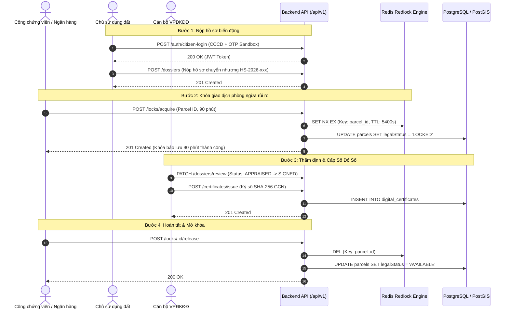

# Tài Liệu Danh Sách API Endpoints - Hệ Thống Địa Chính Số

> Tài liệu đặc tả kỹ thuật chi tiết các điểm cuối API (RESTful API Endpoints) phục vụ nền tảng **Địa Chính Số (Sổ Đỏ Số & CSDL Thửa Đất Thời Gian Thực)** theo quy chuẩn Luật Đất đai 2024.

---

## 1. Tiêu Chuẩn & Quy Ước Chung (API Standards)

- **Giao thức**: HTTP/1.1 & HTTP/2 trên SSL/TLS.
- **Tiền tố đường dẫn (Base URL)**: `http://localhost:4000/api/v1` (hoặc domain Production).
- **Tài liệu OpenAPI / Swagger UI**: `http://localhost:4000/api/docs`.
- **Cơ chế xác thực**: `Authorization: Bearer <JWT_ACCESS_TOKEN>`.
- **Định dạng dữ liệu**: `Content-Type: application/json; charset=utf-8`.
- **Cấu trúc phản hồi chuẩn**:
  ```json
  {
    "statusCode": 200,
    "message": "Thành công",
    "data": { ... },
    "timestamp": "2026-10-19T08:00:00.000Z"
  }
  ```
- **Xử lý mã lỗi chuẩn HTTP**:
  - `400 Bad Request`: Dữ liệu đầu vào sai định dạng (Zod/ValidationPipe).
  - `401 Unauthorized`: Token không hợp lệ hoặc đã hết hạn.
  - `403 Forbidden`: Tài khoản không đủ quyền hạn vai trò (RolesGuard).
  - `404 Not Found`: Không tìm thấy tài nguyên (Thửa đất, Hồ sơ, GCN).
  - `409 Conflict`: Xung đột phiên khóa giao dịch hoặc trùng lặp mã định danh.
  - `500 Internal Server Error`: Lỗi xử lý nội bộ phía máy chủ.

---

## 2. Nhóm API Xác Thực & Định Danh (Auth & Citizen IdP)
**Prefix**: `/api/v1/auth` | **Tags**: `Xác thực & Danh tính (Auth & IdP)`
### [DCS-01-CN-001] Gửi mã xác thực OTP SMS đến số điện thoại công dân (Sandbox & Prod)
- **Method**: `POST`
- **Path**: `/api/v1/auth/citizen/send-otp`
- **Quyền hạn vai trò**: Public (Chủ sử dụng đất / Người dân)
- **Request Body**:
  ```json
  {
    "citizenId": "001090012345",
    "phoneNumber": "0912345678",
    "fullName": "Nguyễn Văn An"
  }
  ```
- **Response `200 OK`**:
  ```json
  {
    "success": true,
    "message": "Mã xác thực OTP gồm 6 chữ số đã được gửi thành công đến số điện thoại 091****678.",
    "expiresInSeconds": 300,
    "mockOtp": "123456"
  }
  ```
- **Mã lỗi đặc thù**:
  - `400 Bad Request`: Số CCCD không đúng 12 chữ số hoặc số điện thoại không hợp lệ.
  - `403 Forbidden`: Tài khoản công dân đang bị tạm khóa hoặc vi phạm quy tắc thẩm quyền địa giới theo QTD-07.

### [DCS-01-CN-001] Xác thực OTP SMS và đăng nhập Cổng Định danh Số Công dân
- **Method**: `POST`
- **Path**: `/api/v1/auth/citizen/verify-otp`
- **Quyền hạn vai trò**: Public (Chủ sử dụng đất)
- **Request Body**:
  ```json
  {
    "citizenId": "001090012345",
    "phoneNumber": "0912345678",
    "otpCode": "123456"
  }
  ```
- **Response `200 OK`**:
  ```json
  {
    "accessToken": "eyJhbGciOiJIUzI1NiIsInR5cCI6IkpXVCJ9...",
    "user": {
      "id": "b3e0c0a1-4321-4f9a-8b1e-7f6a5b4c3d2e",
      "citizenId": "001090012345",
      "fullName": "Nguyễn Văn An",
      "phoneNumber": "0912345678",
      "role": "LAND_USER"
    },
    "auditHash": "a8f9c0e2b1d345f67890abcdef1234567890abcdef1234567890abcdef123456",
    "walletSummary": {
      "parcelCount": 1,
      "certificateCount": 1
    }
  }
  ```
- **Mã lỗi đặc thù**:
  - `400 Bad Request`: Mã OTP sai, mã OTP đã hết hạn hoặc chưa được gửi yêu cầu.
  - `403 Forbidden`: Tài khoản công dân bị tạm khóa theo quy tắc QTD-07.

### [DCS-01-CN-001] Tra cứu Ví Sổ Đỏ Số của Công dân
- **Method**: `GET`
- **Path**: `/api/v1/auth/wallet`
- **Quyền hạn vai trò**: `LAND_USER`, `ADMIN` (Bearer Token)
- **Response `200 OK`**:
  ```json
  {
    "user": {
      "id": "b3e0c0a1-4321-4f9a-8b1e-7f6a5b4c3d2e",
      "citizenId": "001090012345",
      "fullName": "Nguyễn Văn An",
      "role": "LAND_USER",
      "phoneNumber": "0912345678"
    },
    "walletSummary": {
      "parcels": [
        {
          "nationalCode": "HN-BA-DINH.012.0045",
          "sheetNumber": 12,
          "parcelNumber": 45,
          "area": 125.6,
          "address": "Số 18 Phố Liễu Giai, Phường Cống Vị, Quận Ba Đình, Hà Nội",
          "certificateNumber": "CS 123456",
          "status": "AVAILABLE"
        }
      ]
    }
  }
  ```

### [DCS-01-CN-002] Đăng nhập SSO tài khoản công vụ cho cán bộ ngành kèm MFA
- **Method**: `POST`
- **Path**: `/api/v1/auth/officer/sso-login`
- **Quyền hạn vai trò**: Public / Cán bộ ngành (`COMMUNE_OFFICER`, `LAND_REGISTRAR`, `NOTARY_BANK`, `INSPECTOR`, `ADMIN`)
- **Request Body**:
  ```json
  {
    "username": "canbo.convi@diachinh.gov.vn",
    "password": "SecurePassword2026!",
    "mfaCode": "123456",
    "role": "COMMUNE_OFFICER",
    "administrativeUnitCode": "XA_CONG_VI"
  }
  ```
- **Response `200 OK`**:
  ```json
  {
    "accessToken": "eyJhbGciOiJIUzI1NiIsInR5cCI6IkpXVCJ9...",
    "user": {
      "id": "officer-uuid-002",
      "username": "canbo.convi@diachinh.gov.vn",
      "fullName": "Nguyễn Văn Bình",
      "role": "COMMUNE_OFFICER",
      "department": "Phường Cống Vị, Ba Đình, Hà Nội",
      "administrativeUnitCode": "XA_CONG_VI",
      "administrativeUnitName": "Phường Cống Vị, Quận Ba Đình, Hà Nội"
    },
    "auditHash": "e3b0c44298fc1c149afbf4c8996fb92427ae41e4649b934ca495991b7852b855",
    "sessionExpiry": "2026-10-21T18:00:00.000Z"
  }
  ```
- **Mã lỗi đặc thù**:
  - `400 Bad Request`: Dữ liệu đầu vào không hợp lệ hoặc mã MFA không đúng 6 số.
  - `401 Unauthorized`: Mã xác thực MFA không chính xác hoặc đã hết hạn.
  - `403 Forbidden`: Tài khoản bị tạm khóa, vi phạm thẩm quyền địa giới hành chính (QTD-16) hoặc phát hiện địa chỉ IP bất thường ngoài mạng công vụ (QTD-22).

### [DCS-01-CN-003] Lấy danh mục phân cấp địa giới hành chính mô hình 2 cấp (34 Tỉnh thành & Xã/Phường)
- **Method**: `GET`
- **Path**: `/api/v1/jurisdiction/hierarchy`
- **Quyền hạn vai trò**: Tất cả người dùng và cán bộ hệ thống
- **Response `200 OK`**:
  ```json
  {
    "totalUnits": 14,
    "provinces": [
      {
        "code": "TINH_HN",
        "name": "Thành phố Hà Nội",
        "level": "PROVINCE",
        "districts": [
          {
            "code": "HUYEN_BD",
            "name": "Quận Ba Đình",
            "level": "DISTRICT",
            "parentCode": "TINH_HN",
            "communes": [
              {
                "code": "XA_CONG_VI",
                "name": "Phường Cống Vị",
                "level": "COMMUNE",
                "parentCode": "HUYEN_BD"
              }
            ]
          }
        ]
      }
    ]
  }
  ```

### [DCS-01-CN-003] Cấu hình ma trận phân quyền RBAC mô hình 2 cấp tinh gọn
- **Method**: `POST`
- **Path**: `/api/v1/jurisdiction/matrix`
- **Quyền hạn vai trò**: `ADMIN` (Quản trị viên Hệ thống)
- **Request Body**:
  ```json
  {
    "role": "LAND_REGISTRAR",
    "level": "DISTRICT",
    "unitCode": "HUYEN_BD",
    "allowedActions": ["READ", "CREATE", "UPDATE", "APPROVE"],
    "description": "Văn phòng Đăng ký Đất đai Ba Đình"
  }
  ```
- **Response `200 OK`**:
  ```json
  {
    "success": true,
    "message": "Cấu hình ma trận phân quyền cấp hành chính thành công",
    "policy": {
      "id": "pol-1729500000000",
      "role": "LAND_REGISTRAR",
      "level": "DISTRICT",
      "unitCode": "HUYEN_BD",
      "unitName": "Quận Ba Đình",
      "allowedActions": ["READ", "CREATE", "UPDATE", "APPROVE"],
      "description": "Văn phòng Đăng ký Đất đai Ba Đình",
      "updatedAt": "2026-10-21T10:30:00.000Z"
    },
    "auditHash": "7f83b1657ff1fc53b92dc18148a1d65dfc2d4b1fa3d677284addd200126d9069"
  }
  ```
- **Mã lỗi đặc thù**:
  - `400 Bad Request`: Thiếu trường bắt buộc, danh sách quyền rỗng, hoặc mã đơn vị hành chính không tồn tại trong danh mục 3 cấp.
  - `403 Forbidden`: Người dùng không có quyền quản trị viên.

### [DCS-01-CN-003] Đánh giá thẩm quyền truy cập dữ liệu địa chính theo mô hình 2 cấp (QTD-16)
- **Method**: `POST`
- **Path**: `/api/v1/jurisdiction/evaluate`
- **Quyền hạn vai trò**: Tất cả vai trò nghiệp vụ
- **Request Body**:
  ```json
  {
    "userRole": "COMMUNE_OFFICER",
    "userUnitCode": "XA_CONG_VI",
    "action": "READ",
    "targetUnitCode": "XA_CONG_VI"
  }
  ```
- **Response `200 OK` (Thành công - Trong thẩm quyền địa giới)**:
  ```json
  {
    "granted": true,
    "reason": "Thao tác hợp lệ trong phạm vi thẩm quyền địa giới hành chính được phân công (Phường Cống Vị -> Phường Cống Vị)",
    "userLevel": "COMMUNE",
    "targetLevel": "COMMUNE",
    "auditHash": "e3b0c44298fc1c149afbf4c8996fb92427ae41e4649b934ca495991b7852b855"
  }
  ```
- **Mã lỗi đặc thù**:
  - `400 Bad Request`: Mã đơn vị hành chính người dùng hoặc mục tiêu không tồn tại.
  - `403 Forbidden`: Vượt quyền địa giới hành chính theo quy định phân cấp quản lý (QTD-16). Ví dụ cán bộ xã Phường Cống Vị cố thao tác lên dữ liệu của Phường Liễu Giai hoặc Quận Hoàn Kiếm.

### 2.2. Đăng nhập Cán bộ nghiệp vụ liên ngành (SSO / Internal Login)
- **Method**: `POST`
- **Path**: `/api/v1/auth/officer-login`
- **Quyền truy cập**: Public (Cán bộ địa chính, VPĐKĐĐ, Công chứng, Ngân hàng, Thanh tra, Admin)
- **Request Body**:
  ```json
  {
    "username": "canbo_diachinh",
    "password": "Password@2026",
    "role": "COMMUNE_OFFICER"
  }
  ```
- **Response `200 OK`**:
  ```json
  {
    "accessToken": "eyJhbGciOiJIUzI1NiIsIn...",
    "user": {
      "id": "c1f2e3d4-5678-90ab-cdef-1234567890ab",
      "username": "canbo_diachinh",
      "fullName": "Cán bộ NGUYỄN VĂN ĐẠT",
      "role": "COMMUNE_OFFICER",
      "department": "UBND Phường Cống Vị, Ba Đình, Hà Nội"
    }
  }
  ```

### 2.3. Lấy thông tin tài khoản hiện hành từ JWT Token
- **Method**: `GET`
- **Path**: `/api/v1/auth/me`
- **Headers**: `Authorization: Bearer <TOKEN>`
- **Response `200 OK`**: Thông tin người dùng kèm vai trò và thẩm quyền đơn vị.

---

## 3. Nhóm API Quản Lý Thửa Đất (Cadastral Parcels)
**Prefix**: `/api/v1/parcels` | **Tags**: `Quản lý Thửa đất & Bản đồ số (Parcels)`

### 3.1. Lấy danh sách thửa đất (kèm phân trang & bộ lọc)
- **Method**: `GET`
- **Path**: `/api/v1/parcels`
- **Query Params**:
  - `communeId` (tùy chọn): Mã xã/phường (VD: `HN-BA-DINH`)
  - `status` (tùy chọn): `AVAILABLE` | `LOCKED` | `MORTGAGED` | `DISPUTED` | `FROZEN`
- **Response `200 OK`**: Mảng danh sách các thửa đất kèm thông tin ranh giới GeoJSON.

### 3.2. Tra cứu chi tiết thửa đất theo ID
- **Method**: `GET`
- **Path**: `/api/v1/parcels/:id`
- **Response `200 OK`**:
  ```json
  {
    "id": "e6a7c3b2-1234-4567-89ab-cdef01234567",
    "nationalCode": "HN-BA-DINH.012.0045",
    "communeId": "HN-BA-DINH",
    "sheetNumber": 12,
    "parcelNumber": 45,
    "area": 125.6,
    "purposeCode": "ODT",
    "address": "Số 18 Phố Liễu Giai, Phường Cống Vị, Quận Ba Đình, Hà Nội",
    "legalStatus": "AVAILABLE",
    "verticesVN2000": [
      { "pointIndex": 1, "x": 2321450.2, "y": 504210.5 },
      { "pointIndex": 2, "x": 2321462.8, "y": 504225.1 },
      { "pointIndex": 3, "x": 2321448.0, "y": 504238.6 },
      { "pointIndex": 4, "x": 2321435.4, "y": 504224.0 }
    ],
    "boundaryGeojson": {
      "type": "Polygon",
      "coordinates": [[[105.8421, 21.0345], [105.8423, 21.0346], ...]]
    }
  }
  ```

### 3.3. Tra cứu thửa đất theo Mã định danh quốc gia (15 ký tự)
- **Method**: `GET`
- **Path**: `/api/v1/parcels/by-code/:nationalCode`
- **Example**: `/api/v1/parcels/by-code/HN-BA-DINH.012.0045`

### 3.4. Đăng ký mới thửa đất
- **Method**: `POST`
- **Path**: `/api/v1/parcels`
- **Yêu cầu quyền**: `COMMUNE_OFFICER`, `LAND_REGISTRAR`, `ADMIN`
- **Request Body**:
  ```json
  {
    "communeId": "HN-BA-DINH",
    "sheetNumber": 12,
    "parcelNumber": 48,
    "area": 95.5,
    "purposeCode": "ODT",
    "address": "Số 24 Phố Liễu Giai, Phường Cống Vị, Ba Đình, Hà Nội",
    "verticesVN2000": [
      { "pointIndex": 1, "x": 2321495.2, "y": 504260.0 },
      { "pointIndex": 2, "x": 2321510.5, "y": 504275.2 },
      { "pointIndex": 3, "x": 2321498.0, "y": 504288.1 },
      { "pointIndex": 4, "x": 2321478.1, "y": 504275.4 }
    ],
    "ownerIds": ["b3e0c0a1-4321-4f9a-8b1e-7f6a5b4c3d2e"]
  }
  ```

### 3.5. Cập nhật trạng thái pháp lý thửa đất
- **Method**: `PATCH`
- **Path**: `/api/v1/parcels/:id/status`
- **Yêu cầu quyền**: `COMMUNE_OFFICER`, `LAND_REGISTRAR`, `NOTARY_BANK`, `ADMIN`
- **Request Body**: `{ "status": "LOCKED" | "MORTGAGED" | "DISPUTED" | "AVAILABLE" }`

---

## 4. Nhóm API Khóa Giao Dịch Thời Gian Thực (Transaction Lock Engine)
**Prefix**: `/api/v1/locks` | **Tags**: `Khóa Giao dịch Thời gian thực (Real-time Transaction Lock)`

> **Nguyên lý hoạt động**: Áp dụng thuật toán Distributed Lock với Redis Atomic `SET NX EX` (TTL 90 phút). Khi một tổ chức công chứng hoặc chi nhánh ngân hàng kích hoạt khóa phiên, toàn bộ hệ thống lập tức từ chối mọi nỗ lực giao dịch/thế chấp khác đối với thửa đất này.

### 4.1. Kích hoạt khóa giao dịch thửa đất (Acquire Lock)
- **Method**: `POST`
- **Path**: `/api/v1/locks/acquire`
- **Yêu cầu quyền**: `NOTARY_BANK`, `LAND_REGISTRAR`, `ADMIN`
- **Request Body**:
  ```json
  {
    "parcelId": "e6a7c3b2-1234-4567-89ab-cdef01234567",
    "organizationName": "Văn phòng Công chứng Thăng Long",
    "durationMinutes": 90
  }
  ```
- **Response `201 Created`**:
  ```json
  {
    "id": "7a8b9c0d-1e2f-3a4b-5c6d-7e8f9a0b1c2d",
    "parcelId": "e6a7c3b2-1234-4567-89ab-cdef01234567",
    "nationalCode": "HN-BA-DINH.012.0045",
    "organizationName": "Văn phòng Công chứng Thăng Long",
    "sessionToken": "4fa83f21-7294-4d89-9e81-01f28b48c901",
    "status": "ACTIVE",
    "lockedAt": "2026-10-19T08:15:00.000Z",
    "expiresAt": "2026-10-19T09:45:00.000Z",
    "durationMinutes": 90
  }
  ```
- **Error Response `409 Conflict`**:
  ```json
  {
    "statusCode": 409,
    "message": "Thửa đất đang bị khóa bởi Ngân hàng TMCP Ngoại thương Việt Nam. Phiên khóa còn hiệu lực."
  }
  ```

### 4.2. Mở khóa phiên giao dịch (Release Lock)
- **Method**: `POST`
- **Path**: `/api/v1/locks/:lockId/release`
- **Yêu cầu quyền**: `NOTARY_BANK`, `LAND_REGISTRAR`, `ADMIN`
- **Response `200 OK`**: Phiên khóa được chuyển sang `RELEASED`, thửa đất được hoàn nguyên về `AVAILABLE`.

### 4.3. Tra cứu phiên khóa đang hoạt động của thửa đất
- **Method**: `GET`
- **Path**: `/api/v1/locks/parcel/:parcelId`
- **Response `200 OK`**: Trả về chi tiết phiên khóa nếu đang tồn tại, hoặc `null` nếu thửa đất đang mở tự do.

---

## 5. Nhóm API Sổ Đỏ Số & Giấy Chứng Nhận Điện Tử (Certificates)
**Prefix**: `/api/v1/certificates` | **Tags**: `Sổ Đỏ Số & Giấy Chứng Nhận Điện Tử (Certificates)`

### 5.1. Ký số phát hành Sổ Đỏ Số điện tử
- **Method**: `POST`
- **Path**: `/api/v1/certificates/issue`
- **Yêu cầu quyền**: `LAND_REGISTRAR`, `ADMIN`
- **Request Body**:
  ```json
  {
    "parcelId": "e6a7c3b2-1234-4567-89ab-cdef01234567",
    "certificateNumber": "CS 892104",
    "serialNumber": "SR-2026-0045",
    "signerName": "Nguyễn Văn Đạt",
    "signerTitle": "Giám đốc Văn phòng Đăng ký Đất đai",
    "pdfUrl": "https://s3.diachinhso.gov.vn/certificates/CS892104.pdf"
  }
  ```
- **Response `201 Created`**: Tạo GCN điện tử kèm mã băm SHA-256 động và chữ ký số PAdES.

### 5.2. Quét mã QR & Đối soát tính toàn vẹn Sổ Đỏ Số
- **Method**: `GET`
- **Path**: `/api/v1/certificates/verify/:qrHash`
- **Quyền truy cập**: Public (Công dân, Công chứng viên, Cán bộ Tín dụng)
- **Response `200 OK` (Hợp pháp)**:
  ```json
  {
    "isValid": true,
    "message": "Giấy chứng nhận quyền sử dụng đất số hợp pháp, được xác thực chữ ký điện tử từ cơ sở dữ liệu quốc gia.",
    "certificate": { ... },
    "parcel": { ... }
  }
  ```
- **Response `200 OK` (Giả mạo / Không hợp lệ)**:
  ```json
  {
    "isValid": false,
    "message": "CẢNH BÁO: Giấy chứng nhận không tồn tại trên hệ thống hoặc có dấu hiệu làm giả!"
  }
  ```

### 5.3. Xem thông tin Giấy chứng nhận của một thửa đất
- **Method**: `GET`
- **Path**: `/api/v1/certificates/parcel/:parcelId`

---

## 6. Nhóm API Dịch Vụ Công & Biến Động Đất Đai (Dossiers)
**Prefix**: `/api/v1/dossiers` | **Tags**: `Dịch vụ công & Hồ sơ Biến động Đất đai (Dossiers)`

### 6.1. Nộp hồ sơ biến động đất đai trực tuyến
- **Method**: `POST`
- **Path**: `/api/v1/dossiers`
- **Yêu cầu quyền**: `LAND_USER`, `ADMIN`
- **Request Body**:
  ```json
  {
    "parcelId": "e6a7c3b2-1234-4567-89ab-cdef01234567",
    "fluctuationType": "TRANSFER",
    "applicantName": "Nguyễn Văn An",
    "applicantCitizenId": "001090012345",
    "applicantPhone": "0912345678",
    "documentUrls": [
      "https://s3.diachinhso.gov.vn/dossiers/hopdong_chuyennhuong.pdf",
      "https://s3.diachinhso.gov.vn/dossiers/ban_scan_sodo.pdf"
    ],
    "notes": "Hồ sơ chuyển nhượng toàn bộ quyền sử dụng thửa đất số 45 tờ 12."
  }
  ```
- **Response `201 Created`**: Sinh mã hồ sơ chuẩn quốc gia (VD: `HS-2026-784192`).

### 6.2. Lấy danh sách hồ sơ dịch vụ công
- **Method**: `GET`
- **Path**: `/api/v1/dossiers`

### 6.3. Tra cứu chi tiết tiến độ xử lý hồ sơ
- **Method**: `GET`
- **Path**: `/api/v1/dossiers/:id`

### 6.4. Thẩm định / Cập nhật tiến trình hồ sơ (Cán bộ xã & VPĐKĐĐ)
- **Method**: `PATCH`
- **Path**: `/api/v1/dossiers/review`
- **Yêu cầu quyền**: `COMMUNE_OFFICER`, `LAND_REGISTRAR`, `ADMIN`
- **Request Body**:
  ```json
  {
    "dossierId": "d8e7f6a5-4321-0987-ba98-fedcba098765",
    "status": "COMMUNE_VERIFIED",
    "comments": "Đã tiến hành đo đạc xác minh mốc giới hiện trạng tại thực địa, ranh giới không có tranh chấp khiếu nại."
  }
  ```

---

## 7. Nhóm API Bản Đồ Số & Không Gian GIS (Spatial GIS)
**Prefix**: `/api/v1/spatial` | **Tags**: `Bản đồ số & Không gian GIS (Spatial GIS)`

### 7.1. Chuyển đổi đỉnh ranh giới VN-2000 sang GeoJSON Polygon WGS84
- **Method**: `POST`
- **Path**: `/api/v1/spatial/transform-vn2000`
- **Request Body**:
  ```json
  {
    "vertices": [
      { "pointIndex": 1, "x": 2321450.2, "y": 504210.5 },
      { "pointIndex": 2, "x": 2321462.8, "y": 504225.1 },
      { "pointIndex": 3, "x": 2321448.0, "y": 504238.6 },
      { "pointIndex": 4, "x": 2321435.4, "y": 504224.0 }
    ],
    "srid": 3405
  }
  ```
- **Response `200 OK`**: Polygon Feature WGS84 (EPSG:4326) để vẽ trực tiếp trên MapLibre GL.

### 7.2. Kiểm tra chồng lấn quy hoạch không gian xây dựng
- **Method**: `POST`
- **Path**: `/api/v1/spatial/check-zoning`
- **Response `200 OK`**: Thông tin phân khu quy hoạch, giới hạn tầng cao, mật độ xây dựng.

---

## 8. Sơ Đồ Quy Trình Tương Tác Giữa Các Endpoints




---

## 9. Nhóm API Ký Số Chuyên Dùng Công Vụ & SmartCA (Digital Signature & SmartCA)
**Prefix**: `/api/v1/digital-signature` | **Tags**: `Tích hợp Chữ ký số Chuyên dùng Công vụ & SmartCA (DCS-01-CN-004)`

### 9.1. [DCS-01-CN-004] Tra cứu danh sách chứng thư số chuyên dùng công vụ & SmartCA
- **Method**: `GET`
- **Path**: `/api/v1/digital-signature/certificates`
- **Yêu cầu quyền (RBAC)**: `LAND_REGISTRAR`, `ADMIN`
- **Query Params**: `role?: UserRole`
- **Response `200 OK`**:
  ```json
  [
    {
      "serialNumber": "GOV-CA-VPDKDD-001",
      "subjectName": "Nguyễn Văn An",
      "subjectTitle": "Giám đốc Văn phòng Đăng ký Đất đai",
      "organization": "Văn phòng Đăng ký Đất đai - Sở Tài nguyên và Môi trường",
      "provider": "GOVERNMENT_CA",
      "issuer": "Ban Cơ yếu Chính phủ - Cục Chứng thực số và Bảo mật thông tin",
      "validFrom": "2024-01-01T00:00:00Z",
      "validTo": "2027-12-31T23:59:59Z",
      "ocspStatus": "VALID",
      "isDefault": true
    }
  ]
  ```
- **Mã lỗi**:
  - `403 Forbidden`: Tài khoản không đủ quyền truy cập danh bạ chứng thư công vụ chuyên dùng.

### 9.2. [DCS-01-CN-004] Kiểm tra trực tuyến trạng thái thu hồi chứng thư số qua OCSP (QTD-28)
- **Method**: `GET`
- **Path**: `/api/v1/digital-signature/ocsp-check/:serialNumber`
- **Yêu cầu quyền (RBAC)**: `LAND_REGISTRAR`, `ADMIN`
- **Response `200 OK` (Chứng thư số hợp lệ)**:
  ```json
  {
    "serialNumber": "GOV-CA-VPDKDD-001",
    "status": "VALID",
    "checkedAt": "2026-10-22T09:40:00.000Z",
    "responderUrl": "https://ocsp.ca.gov.vn",
    "isValid": true,
    "reason": "Chứng thư số công vụ hợp lệ, danh sách thu hồi CRL và phản hồi OCSP an toàn."
  }
  ```
- **Response `200 OK` (Chứng thư số đã bị thu hồi)**:
  ```json
  {
    "serialNumber": "GOV-CA-REVOKED-009",
    "status": "REVOKED",
    "checkedAt": "2026-10-22T09:40:00.000Z",
    "responderUrl": "https://ocsp.ca.gov.vn",
    "isValid": false,
    "reason": "Chứng thư số đã bị thu hồi trực tuyến theo yêu cầu của đơn vị quản lý cán bộ."
  }
  ```
- **Mã lỗi**:
  - `400 Bad Request`: Số serial rỗng hoặc không tồn tại trong danh bạ quản lý CA.

### 9.3. [DCS-01-CN-004] Lấy danh sách hồ sơ địa chính chờ ký số phê duyệt
- **Method**: `GET`
- **Path**: `/api/v1/digital-signature/pending-dossiers`
- **Yêu cầu quyền (RBAC)**: `LAND_REGISTRAR`, `ADMIN`
- **Response `200 OK`**:
  ```json
  [
    {
      "id": "DOSSIER-2026-HN-001",
      "dossierCode": "HS-2026-001-HN",
      "parcelId": "PARCEL-HN-001",
      "parcelNationalCode": "01001-0012-0045",
      "applicantName": "Trần Văn Hoàng",
      "applicantCitizenId": "001090123456",
      "fluctuationType": "TRANSFER",
      "status": "APPRAISED",
      "submittedAt": "2026-10-20T08:30:00Z",
      "communeName": "Phường Điện Biên",
      "provinceName": "Thành phố Hà Nội",
      "isParcelLocked": false
    }
  ]
  ```

### 9.4. [DCS-01-CN-004] Ký số phê duyệt hồ sơ địa chính bằng chứng thư số công vụ hoặc SmartCA (QTD-05, QTD-28)
- **Method**: `POST`
- **Path**: `/api/v1/digital-signature/sign-approval`
- **Yêu cầu quyền (RBAC)**: `LAND_REGISTRAR`, `ADMIN` (QTD-05)
- **Request Body**:
  ```json
  {
    "dossierId": "DOSSIER-2026-HN-001",
    "signerRole": "LAND_REGISTRAR",
    "provider": "GOVERNMENT_CA",
    "certificateSerial": "GOV-CA-VPDKDD-001",
    "reason": "Phê duyệt hồ sơ đăng ký biến động chuyển nhượng quyền sử dụng đất",
    "signaturePin": "123456"
  }
  ```
- **Response `200 OK`**:
  ```json
  {
    "success": true,
    "dossierId": "DOSSIER-2026-HN-001",
    "documentId": "DOC_HS-2026-001-HN_APPROVED",
    "signatureValue": "SIG_PADES_RSA2048_e8c4b92f7d1a5e30894b1592c68f1234567890abcdef",
    "certificateSerial": "GOV-CA-VPDKDD-001",
    "signerName": "Nguyễn Văn An",
    "provider": "GOVERNMENT_CA",
    "signatureStandard": "PADES",
    "timestamp": "2026-10-22T09:40:00.000Z",
    "ocspVerified": true,
    "auditHash": "e8c4b92f7d1a5e30894b1592c68f1234567890abcdef1234567890abcdef1234",
    "dossierStatus": "SIGNED",
    "message": "Ký số chuyên dùng công vụ phê duyệt hồ sơ địa chính thành công. Văn bản điện tử đã được gắn chữ ký số hợp lệ và dấu thời gian TSA."
  }
  ```
- **Mã lỗi**:
  - `400 Bad Request`: Dữ liệu đầu vào sai định dạng, thiếu trường bắt buộc, hoặc không tìm thấy hồ sơ.
  - `403 Forbidden`: Tài khoản không thuộc Văn phòng ĐKĐĐ (QTD-05) hoặc chứng thư số bị thu hồi/hết hạn qua OCSP (QTD-28).
  - `409 Conflict`: Thửa đất liên quan đến hồ sơ đang bị khóa giao dịch (90 phút) hoặc đang trong thụ lý tranh chấp ranh giới.

### 9.5. [DCS-01-CN-004] Xác minh tính hợp pháp và toàn vẹn của chữ ký số
- **Method**: `POST`
- **Path**: `/api/v1/digital-signature/verify`
- **Request Body**:
  ```json
  {
    "signatureValue": "SIG_PADES_RSA2048_e8c4b92f7d1a5e30894b1592c68f1234567890abcdef",
    "certificateSerial": "GOV-CA-VPDKDD-001"
  }
  ```
- **Response `200 OK`**:
  ```json
  {
    "valid": true,
    "signerName": "Nguyễn Văn An",
    "issuer": "Ban Cơ yếu Chính phủ - Cục Chứng thực số và Bảo mật thông tin",
    "provider": "GOVERNMENT_CA",
    "ocspStatus": "VALID",
    "timestamp": "2026-10-22T09:40:00.000Z",
    "auditHash": "d8e3f2a1b0c9...",
    "message": "Chữ ký số hợp pháp, toàn vẹn, được xác thực trực tuyến qua cổng OCSP của Ban Cơ yếu Chính phủ."
  }
  ```


---

## 10. Nhóm API Quản Lý Phiên Làm Việc & Bảo Mật Xác Thực 2FA (Session Security & Step-Up 2FA)
**Prefix**: `/api/v1/session-security` | **Tags**: `Quản lý Phiên làm việc & Bảo mật Xác thực 2FA (DCS-01-CN-005)`

### 10.1. [DCS-01-CN-005] Tra cứu danh sách các phiên làm việc đang hoạt động
- **Method**: `GET`
- **Path**: `/api/v1/session-security/sessions`
- **Query Params**: `userId?: string`
- **Response `200 OK`**:
  ```json
  [
    {
      "id": "SES-HN-ADMIN-001",
      "userId": "USR-ADMIN-001",
      "username": "admin.hanoi@diachinh.gov.vn",
      "fullName": "Nguyễn Văn An",
      "role": "ADMIN",
      "deviceInfo": "Chrome 122 on Windows 11 (Máy trạm công vụ VP ĐKĐĐ)",
      "ipAddress": "10.12.34.56",
      "isTrustedIp": true,
      "status": "ACTIVE",
      "createdAt": "2026-10-22T09:30:00.000Z",
      "lastActiveAt": "2026-10-22T10:05:00.000Z",
      "expiresAt": "2026-10-22T10:20:00.000Z",
      "inactivityTimeoutSeconds": 900
    }
  ]
  ```

### 10.2. [DCS-01-CN-005] Tự động hoặc chủ động khóa màn hình làm việc (Timeout 15 phút)
- **Method**: `POST`
- **Path**: `/api/v1/session-security/lock`
- **Request Body**:
  ```json
  {
    "sessionId": "SES-HN-ADMIN-001"
  }
  ```
- **Response `200 OK`**: Chuyển trạng thái phiên sang `LOCKED`.

### 10.3. [DCS-01-CN-005] Mở khóa phiên làm việc bằng mã PIN/2FA (Làm mới phiên 15 phút, QTD-22)
- **Method**: `POST`
- **Path**: `/api/v1/session-security/unlock`
- **Request Body**:
  ```json
  {
    "sessionId": "SES-HN-REGISTRAR-002",
    "unlockCode": "123456"
  }
  ```
- **Response `200 OK`**:
  ```json
  {
    "success": true,
    "sessionId": "SES-HN-REGISTRAR-002",
    "status": "ACTIVE",
    "refreshedExpiry": "2026-10-22T10:35:00.000Z",
    "auditHash": "e8c4b92f7d1a5e30...",
    "message": "Mở khóa phiên làm việc thành công. Phiên đã được làm mới thời gian bảo vệ 15 phút."
  }
  ```
- **Mã lỗi**:
  - `400 Bad Request`: Mã mở khóa sai hoặc dữ liệu thiếu trường bắt buộc.
  - `403 Forbidden`: Nhập sai quá 3 lần liên tiếp, phiên bị tạm khóa theo quy tắc an toàn thông tin (QTD-22).

### 10.4. [DCS-01-CN-005] Yêu cầu xác thực 2 lớp nâng cao (Step-Up 2FA Challenge)
- **Method**: `POST`
- **Path**: `/api/v1/session-security/step-up/challenge`
- **Request Body**:
  ```json
  {
    "sessionId": "SES-HN-ADMIN-001",
    "operation": "APPROVE_CERTIFICATE",
    "targetEntityId": "DOC-2026-CERT-001"
  }
  ```
- **Response `200 OK`**:
  ```json
  {
    "challengeId": "CHL_121372fd6fada2cd",
    "operation": "APPROVE_CERTIFICATE",
    "method": "TOTP",
    "expiresInSeconds": 300,
    "maskedPhone": "09*****678",
    "mockOtp": "123456"
  }
  ```
- **Mã lỗi**:
  - `403 Forbidden`: Phát hiện truy cập thao tác nhạy cảm từ IP ngoài mạng công vụ (QTD-22) hoặc phiên không ở trạng thái `ACTIVE`.

### 10.5. [DCS-01-CN-005] Xác nhận mã 2FA nâng cao và cấp Token ủy quyền (5 phút)
- **Method**: `POST`
- **Path**: `/api/v1/session-security/step-up/verify`
- **Request Body**:
  ```json
  {
    "challengeId": "CHL_121372fd6fada2cd",
    "sessionId": "SES-HN-ADMIN-001",
    "code": "123456"
  }
  ```
- **Response `200 OK`**:
  ```json
  {
    "success": true,
    "stepUpToken": "STEPUP_a1b2c3d4e5f6...",
    "operation": "APPROVE_CERTIFICATE",
    "expiresAt": "2026-10-22T10:40:00.000Z",
    "auditHash": "3a8f9c1b2d4e6f80...",
    "message": "Xác thực 2FA nâng cao thành công. Đã cấp mã ủy quyền thực hiện thao tác nhạy cảm trong vòng 5 phút."
  }
  ```
- **Mã lỗi**:
  - `400 Bad Request`: Mã 2FA sai, mã thử thách đã được dùng trước đó (Single-use), hoặc đã quá hạn 5 phút.
  - `403 Forbidden`: Xác thực sai quá 3 lần liên tiếp, phiên bị tạm khóa theo QTD-22.

### 10.6. [DCS-01-CN-005] Chấm dứt phiên làm việc từ xa (Remote Session Termination)
- **Method**: `POST`
- **Path**: `/api/v1/session-security/terminate`
- **Request Body**:
  ```json
  {
    "sessionId": "SES-HN-ADMIN-001",
    "reason": "Cán bộ đăng xuất phiên làm việc"
  }
  ```
- **Response `200 OK`**: Chuyển trạng thái phiên sang `TERMINATED`.

### 10.7. [DCS-01-CN-005] Tra cứu danh sách cảnh báo vi phạm an toàn thông tin (QTD-22)
- **Method**: `GET`
- **Path**: `/api/v1/session-security/alerts`
- **Response `200 OK`**:
  ```json
  [
    {
      "id": "ALT-2026-001",
      "sessionId": "SES-SUSPICIOUS-003",
      "username": "lehoangnam@diachinh.gov.vn",
      "ipAddress": "198.51.100.99",
      "violationType": "IP_NOT_IN_WHITELIST",
      "description": "Phát hiện đăng nhập tài khoản công chức từ địa chỉ IP ngoài mạng công vụ. Kích hoạt tạm khóa phiên bảo vệ hệ thống.",
      "timestamp": "2026-10-22T10:00:00.000Z",
      "auditHash": "a7b3c2d1e0f9..."
    }
  ]
  ```


---

## 11. Nhóm API Quản Lý Vòng Đời & Điều Chuyển Cán Bộ Công Vụ (Officer Lifecycle & Account Deactivation)
**Prefix**: `/api/v1/officer-lifecycle` | **Tags**: `Quản lý Vòng đời & Điều chuyển Cán bộ Công vụ (DCS-01-CN-006)`

### 11.1. [DCS-01-CN-006] Tra cứu danh sách tài khoản cán bộ công vụ
- **Method**: `GET`
- **Path**: `/api/v1/officer-lifecycle/officers`
- **Query Params**:
  - `unitCode?: string`: Mã đơn vị hành chính
  - `role?: UserRole`: Vai trò nghiệp vụ
  - `status?: OfficerAccountStatus`: Trạng thái (`ACTIVE`, `TRANSFERRED`, `SUSPENDED_DISCIPLINE`, `DISMISSED`, `RESIGNED`)
  - `search?: string`: Từ khóa tìm kiếm họ tên, mã cán bộ, email
- **Response `200 OK`**: Danh sách cán bộ kèm số lượng hồ sơ dở dang và thông tin quyết định điều chuyển nếu có.

### 11.2. [DCS-01-CN-006] Tra cứu chi tiết một hồ sơ cán bộ công vụ
- **Method**: `GET`
- **Path**: `/api/v1/officer-lifecycle/officers/:id`
- **Response `200 OK`**: Chi tiết thông tin công tác, đơn vị hành chính và lịch sử điều chuyển.

### 11.3. [DCS-01-CN-006] Lấy danh sách cán bộ đủ điều kiện nhận bàn giao hồ sơ
- **Method**: `GET`
- **Path**: `/api/v1/officer-lifecycle/officers/:id/eligible-transferees`
- **Response `200 OK`**: Danh sách các cán bộ cùng cấp hoặc cùng đơn vị đang ở trạng thái hoạt động bình thường (`ACTIVE`).

### 11.4. [DCS-01-CN-006] Khóa và vô hiệu hóa tài khoản công vụ khi điều chuyển, kỷ luật, thôi việc
- **Method**: `POST`
- **Path**: `/api/v1/officer-lifecycle/deactivate`
- **Header**: `Authorization: Bearer <Admin_Token>`
- **Request Body**:
  ```json
  {
    "officerId": "OFF-HN-001",
    "decisionNumber": "QĐ-2026/088/UBND-HN",
    "decisionDate": "2026-10-22",
    "issuingAuthority": "UBND Thành phố Hà Nội",
    "reasonType": "TRANSFER",
    "reasonDetail": "Điều động công tác sang Sở Xây dựng theo đề án luân chuyển",
    "transfereeOfficerId": "OFF-HN-002"
  }
  ```
- **Response `200 OK`**:
  ```json
  {
    "success": true,
    "officerId": "OFF-HN-001",
    "officerName": "Nguyễn Văn An",
    "newStatus": "TRANSFERRED",
    "terminatedSessionsCount": 1,
    "reassignedDossiersCount": 4,
    "transfereeOfficerName": "Trần Thị Bích",
    "auditHash": "463eb3edcaa50d4a6bf2025bc3aa3691d908afeab76efaaa1533cc91b0286544",
    "deactivatedAt": "2026-10-22T10:30:00.000Z",
    "message": "Đã vô hiệu hóa tài khoản cán bộ công vụ thành công theo quyết định QĐ-2026/088/UBND-HN"
  }
  ```
- **Mã lỗi**:
  - `400 Bad Request`: Thiếu thông tin quyết định hành chính, ngày sai định dạng, hoặc cán bộ đang giữ hồ sơ dở dang nhưng không chỉ định cán bộ bàn giao. Quản trị viên tự khóa tài khoản của chính mình (Self-lockout).
  - `403 Forbidden`: Người gửi không có vai trò Quản trị viên Hệ thống (`ADMIN`).
  - `404 Not Found`: Không tìm thấy mã cán bộ hoặc cán bộ tiếp nhận.
  - `409 Conflict`: Tài khoản đã ở trạng thái mục tiêu.

### 11.5. [DCS-01-CN-006] Chuyển giao hồ sơ địa chính giữa 2 cán bộ công vụ
- **Method**: `POST`
- **Path**: `/api/v1/officer-lifecycle/transfer-dossiers`
- **Request Body**:
  ```json
  {
    "fromOfficerId": "OFF-HN-001",
    "toOfficerId": "OFF-HN-002",
    "reason": "Bàn giao hồ sơ theo quyết định điều động công tác"
  }
  ```
- **Response `200 OK`**: Chuyển giao hồ sơ thành công kèm mã băm SHA-256.

### 11.6. [DCS-01-CN-006] Khôi phục tài khoản cán bộ công vụ
- **Method**: `POST`
- **Path**: `/api/v1/officer-lifecycle/reactivate`
- **Request Body**:
  ```json
  {
    "officerId": "OFF-NB-001",
    "decisionNumber": "QĐ-2026/999/UBND-NB-TIEP-NHAN",
    "reinstatementReason": "Quyết định tiếp nhận cán bộ trở lại vị trí công tác"
  }
  ```
- **Response `200 OK`**: Khôi phục trạng thái `ACTIVE` kèm mã băm SHA-256.

### 11.7. [DCS-01-CN-006] Tra cứu nhật ký kiểm toán điều chuyển nhân sự
- **Method**: `GET`
- **Path**: `/api/v1/officer-lifecycle/audit-logs`
- **Response `200 OK`**: Danh sách lịch sử điều chuyển, vô hiệu hóa, bàn giao hồ sơ kèm mã băm SHA-256.


---

## 12. Nhóm API Cấu Hình Chính Sách Mật Khẩu & Chống Tấn Công Dò Quét (Password Policy & Brute-Force Protection)
**Prefix**: `/api/v1/password-policy` | **Tags**: `Chính sách Mật khẩu & Chống Dò quét (DCS-01-CN-007)`

### 12.1. [DCS-01-CN-007] Lấy cấu hình chính sách mật khẩu công vụ hiện hành
- **Method**: `GET`
- **Path**: `/api/v1/password-policy/config`
- **Response `200 OK`**:
  ```json
  {
    "minLength": 10,
    "requireUppercase": true,
    "requireLowercase": true,
    "requireNumbers": true,
    "requireSpecialChars": true,
    "passwordExpiryDays": 90,
    "preventPasswordReuseCount": 5,
    "maxFailedAttempts": 5,
    "lockoutDurationMinutes": 30,
    "trustedIpRanges": ["10.0.0.0/8", "192.168.1.0/24"],
    "updatedAt": "2026-10-22T10:40:00.000Z",
    "updatedBy": "quantri.hethong",
    "auditHash": "9179e9deef37e7b4f4ce4e58b84faea392350ec055c965552ef4b7f08b5aa99d"
  }
  ```

### 12.2. [DCS-01-CN-007] Cập nhật cấu hình chính sách mật khẩu và chống brute-force
- **Method**: `PUT`
- **Path**: `/api/v1/password-policy/config`
- **Header**: `Authorization: Bearer <Admin_Token>`
- **Request Body**:
  ```json
  {
    "minLength": 12,
    "requireUppercase": true,
    "requireLowercase": true,
    "requireNumbers": true,
    "requireSpecialChars": true,
    "passwordExpiryDays": 60,
    "preventPasswordReuseCount": 6,
    "maxFailedAttempts": 5,
    "lockoutDurationMinutes": 45
  }
  ```
- **Response `200 OK`**: Cấu hình mới cập nhật kèm mã băm SHA-256.
- **Mã lỗi**:
  - `400 Bad Request`: `minLength < 8` hoặc `> 32`, `maxFailedAttempts < 3`, `lockoutDurationMinutes < 5`.
  - `403 Forbidden`: Người gửi không phải Quản trị viên Hệ thống (`ADMIN`).

### 12.3. [DCS-01-CN-007] Kiểm tra độ mạnh và tính hợp lệ của mật khẩu
- **Method**: `POST`
- **Path**: `/api/v1/password-policy/validate-password`
- **Request Body**:
  ```json
  {
    "password": "DiaChinhSo@2026!Vn",
    "username": "canbo.hanoi"
  }
  ```
- **Response `200 OK`**:
  ```json
  {
    "valid": true,
    "score": 95,
    "strength": "VERY_STRONG",
    "errors": []
  }
  ```

### 12.4. [DCS-01-CN-007] Lấy danh sách địa chỉ IP đang bị khóa do tấn công brute-force
- **Method**: `GET`
- **Path**: `/api/v1/password-policy/blocked-ips`
- **Response `200 OK`**: Danh sách IP bị khóa kèm lý do, thời gian hết hạn và mã băm SHA-256.

### 12.5. [DCS-01-CN-007] Mở khóa thủ công cho một địa chỉ IP
- **Method**: `POST`
- **Path**: `/api/v1/password-policy/unblock-ip`
- **Header**: `Authorization: Bearer <Admin_Token>`
- **Request Body**:
  ```json
  {
    "ipAddress": "203.0.113.45",
    "reason": "Cán bộ xác nhận quên mật khẩu và đã được cấp lại thông tin"
  }
  ```
- **Response `200 OK`**: Mở khóa thành công kèm mã băm SHA-256.
- **Mã lỗi**:
  - `403 Forbidden`: Người gửi không phải Quản trị viên.
  - `404 Not Found`: Địa chỉ IP không nằm trong danh sách bị khóa.

### 12.6. [DCS-01-CN-007] Tra cứu nhật ký kiểm toán cấu hình bảo mật
- **Method**: `GET`
- **Path**: `/api/v1/password-policy/audit-logs`
- **Response `200 OK`**: Danh sách lịch sử thay đổi cấu hình bảo mật kèm mã băm SHA-256.


---

## 13. Nhóm API Quản Lý Ủy Quyền Giải Quyết Hồ Sơ Địa Chính Có Thời Hạn (Timed Delegation)
**Prefix**: `/api/v1/delegation` | **Tags**: `Quản lý Ủy quyền Ký duyệt Hồ sơ (DCS-01-CN-008)`

### 13.1. [DCS-01-CN-008] Lấy danh sách văn bản ủy quyền giải quyết hồ sơ
- **Method**: `GET`
- **Path**: `/api/v1/delegation/list`
- **Query Params**:
  - `status?: DelegationStatus`: Trạng thái (`ACTIVE`, `PENDING`, `EXPIRED`, `REVOKED`)
  - `delegateeId?: string`: Mã cán bộ nhận ủy quyền
- **Response `200 OK`**: Danh sách các văn bản ủy quyền.

### 13.2. [DCS-01-CN-008] Lấy thông tin chi tiết một văn bản ủy quyền
- **Method**: `GET`
- **Path**: `/api/v1/delegation/:id`
- **Response `200 OK`**: Chi tiết văn bản ủy quyền.

### 13.3. [DCS-01-CN-008] Ban hành văn bản ủy quyền giải quyết hồ sơ có thời hạn
- **Method**: `POST`
- **Path**: `/api/v1/delegation/create`
- **Header**: `Authorization: Bearer <Leader_Token>`
- **Request Body**:
  ```json
  {
    "documentNumber": "QĐ-UQ-2026/015/VPDKDD-HN",
    "title": "Ủy quyền ký số phê duyệt Giấy chứng nhận quyền sử dụng đất trong thời gian Giám đốc đi công tác",
    "delegateeId": "OFF-HN-VPDK-001",
    "scope": "APPROVE_CERTIFICATE",
    "startDate": "2026-10-20T00:00:00.000Z",
    "endDate": "2026-10-30T23:59:59.000Z",
    "notes": "Ủy quyền ký phê duyệt hồ sơ địa chính và sổ đỏ số"
  }
  ```
- **Response `200 OK`**:
  ```json
  {
    "success": true,
    "delegation": {
      "id": "DEL-2026-001",
      "documentNumber": "QĐ-UQ-2026/015/VPDKDD-HN",
      "delegateeName": "Lê Văn Cường",
      "signingPrefix": "KT. GIÁM ĐỐC - PHÓ GIÁM ĐỐC",
      "status": "ACTIVE",
      "auditHash": "1987c3331c95c63db72288fbec4b75d7192bd90fe8a3855a86d1bfb52774e660"
    },
    "auditHash": "1987c3331c95c63db72288fbec4b75d7192bd90fe8a3855a86d1bfb52774e660",
    "message": "Đã thiết lập văn bản ủy quyền 'QĐ-UQ-2026/015/VPDKDD-HN' thành công"
  }
  ```
- **Mã lỗi**:
  - `400 Bad Request`: `startDate >= endDate`, hoặc người ủy quyền trùng người được ủy quyền.
  - `403 Forbidden`: Người tạo không thuộc vai trò Lãnh đạo Văn phòng ĐKĐĐ (`LAND_REGISTRAR`) hoặc Quản trị viên (`ADMIN`).
  - `404 Not Found`: Không tìm thấy cán bộ được ủy quyền.

### 13.4. [DCS-01-CN-008] Thu hồi văn bản ủy quyền trước thời hạn
- **Method**: `POST`
- **Path**: `/api/v1/delegation/revoke`
- **Request Body**:
  ```json
  {
    "delegationId": "DEL-2026-001",
    "reason": "Giám đốc đã hoàn thành chuyến công tác sớm hơn dự kiến và trở lại điều hành"
  }
  ```
- **Response `200 OK`**: Thu hồi ủy quyền thành công kèm mã băm SHA-256.

### 13.5. [DCS-01-CN-008] Kiểm tra thẩm quyền ủy quyền của cán bộ khi thực hiện ký duyệt
- **Method**: `POST`
- **Path**: `/api/v1/delegation/verify-access`
- **Request Body**:
  ```json
  {
    "officerId": "OFF-HN-VPDK-001",
    "requiredScope": "APPROVE_CERTIFICATE"
  }
  ```
- **Response `200 OK`**:
  ```json
  {
    "hasDelegation": true,
    "signingTitle": "KT. GIÁM ĐỐC - PHÓ GIÁM ĐỐC",
    "message": "Cán bộ có văn bản ủy quyền hợp lệ 'QĐ-UQ-2026/015/VPDKDD-HN' để ký thay Giám đốc"
  }
  ```

### 13.6. [DCS-01-CN-008] Tra cứu nhật ký kiểm toán ủy quyền
- **Method**: `GET`
- **Path**: `/api/v1/delegation/audit/logs`
- **Response `200 OK`**: Danh sách lịch sử ban hành và thu hồi ủy quyền kèm mã băm SHA-256.


---

## 14. Nhóm API Đăng Nhập & Phân Quyền Tài Khoản Tổ Chức Qua Cổng Định Danh Doanh Nghiệp [DCS-01-CN-009]

### 14.1. [DCS-01-CN-009] Đăng nhập Cổng Định danh Doanh nghiệp qua Mã số thuế và USB Token / HSM
- **Method**: `POST`
- **Path**: `/api/v1/enterprise-idp/login`
- **Yêu cầu quyền (RBAC)**: Public / Doanh nghiệp
- **Request Body**:
  ```json
  {
    "taxCode": "0101234567",
    "authMethod": "USB_TOKEN",
    "tokenSerial": "VNP-CA-ENT-001928",
    "signature": "SIG_RSA2048_ENT_0101234567_SAMPLE_HASH_APPROVED"
  }
  ```
- **Response `200 OK`**:
  ```json
  {
    "success": true,
    "accessToken": "ey...",
    "enterprise": {
      "id": "ENT-0101234567",
      "taxCode": "0101234567",
      "enterpriseName": "Tập đoàn Đầu tư Phát triển Đô thị Thủ Đô",
      "legalRepresentativeName": "Nguyễn Thế Hưng",
      "legalRepresentativeCitizenId": "001080009988",
      "headquartersAddress": "Số 18 Hoàng Diệu, Phường Điện Biên, Tỉnh Hà Nội",
      "authMethod": "USB_TOKEN",
      "tokenSerial": "VNP-CA-ENT-001928",
      "isVerifiedTaxAuthority": true
    },
    "projectParcels": [
      {
        "id": "EP-01",
        "parcelCode": "01001-0025-0010",
        "projectName": "Khu đô thị sinh thái Sông Hồng",
        "areaSquareMeters": 45200.5,
        "purposeOfUse": "Đất thương mại, dịch vụ",
        "legalStatus": "Đã cấp Giấy chứng nhận quyền sử dụng đất",
        "isLocked": false
      }
    ],
    "message": "Đăng nhập Cổng Định danh Doanh nghiệp thành công"
  }
  ```
- **Mã lỗi**:
  - `400 Bad Request`: Mã số thuế không đúng định dạng (10 hoặc 13 chữ số), hoặc thiếu chữ ký số xác thực.
  - `404 Not Found`: Không tìm thấy doanh nghiệp trong cơ sở dữ liệu quốc gia đăng ký doanh nghiệp.

### 14.2. [DCS-01-CN-009] Lấy thông tin hồ sơ doanh nghiệp & danh sách nhân viên được phân quyền
- **Method**: `GET`
- **Path**: `/api/v1/enterprise-idp/profile/:taxCode`
- **Response `200 OK`**: Thông tin doanh nghiệp, danh sách nhân viên ủy quyền và danh sách thửa đất dự án.

### 14.3. [DCS-01-CN-009] Lấy danh sách thửa đất thuộc quyền sử dụng hợp pháp của doanh nghiệp
- **Method**: `GET`
- **Path**: `/api/v1/enterprise-idp/parcels/:taxCode`
- **Response `200 OK`**: Danh mục các thửa đất dự án do doanh nghiệp đứng tên kèm diện tích và tình trạng pháp lý (không hiển thị thửa đất ngoài phạm vi dự án).

### 14.4. [DCS-01-CN-009] Phân quyền cho nhân sự nội bộ nộp/tra cứu hồ sơ địa chính dự án
- **Method**: `POST`
- **Path**: `/api/v1/enterprise-idp/staff/assign`
- **Request Body**:
  ```json
  {
    "taxCode": "0101234567",
    "staffCitizenId": "001095001234",
    "staffFullName": "Trần Thị Thu Trang",
    "staffRole": "Chuyên viên Pháp lý Dự án",
    "assignedParcelIds": ["EP-01"],
    "permissions": ["SUBMIT_DOSSIER", "TRACK_PROGRESS", "VIEW_LAND_DATA"],
    "validUntil": "2027-12-31T23:59:59.000Z"
  }
  ```
- **Response `200 OK`**: Phân quyền nhân sự thành công kèm mã băm SHA-256 bất biến.
- **Mã lỗi**:
  - `400 Bad Request`: Số CCCD không hợp lệ hoặc thời hạn phân quyền đã qua.
  - `404 Not Found`: Doanh nghiệp không tồn tại.

### 14.5. [DCS-01-CN-009] Thu hồi quyền nộp/tra cứu hồ sơ địa chính của nhân sự
- **Method**: `POST`
- **Path**: `/api/v1/enterprise-idp/staff/remove`
- **Request Body**:
  ```json
  {
    "taxCode": "0101234567",
    "staffCitizenId": "001095001234",
    "reason": "Điều chuyển nhân sự sang dự án khác"
  }
  ```
- **Response `200 OK`**: Thu hồi quyền nhân viên thành công kèm mã băm SHA-256 ghi nhận vào nhật ký kiểm toán.

### 14.6. [DCS-01-CN-009] Tra cứu nhật ký kiểm toán phân quyền doanh nghiệp
- **Method**: `GET`
- **Path**: `/api/v1/enterprise-idp/audit/logs`
- **Response `200 OK`**: Danh sách lịch sử phân quyền và thu hồi quyền nhân viên của doanh nghiệp.


---

## 15. Nhóm API Nhật Ký Xác Thực & Phát Hiện Cảnh Báo Đăng Nhập Bất Thường [DCS-01-CN-010]

### 15.1. [DCS-01-CN-010] Truy vấn sổ cái nhật ký xác thực liên kết chuỗi băm bất biến (QTD-20)
- **Method**: `GET`
- **Path**: `/api/v1/auth-audit/logs`
- **Yêu cầu quyền (RBAC)**: `ADMIN`, `INSPECTOR`
- **Query Params**:
  - `actorId` (string, tùy chọn): Lọc theo mã định danh người dùng / cán bộ
  - `role` (string, tùy chọn): Lọc theo vai trò hệ thống
  - `status` (string, tùy chọn): `SUCCESS`, `FAILED`, `CHALLENGED`, `BLOCKED`
  - `isAnomaly` (boolean, tùy chọn): Chỉ lấy các sự kiện bất thường (`true`/`false`)
  - `page` (number, mặc định `1`): Số trang
  - `limit` (number, mặc định `20`): Số lượng bản ghi trên một trang
- **Response `200 OK`**:
  ```json
  {
    "logs": [
      {
        "id": "LOG-2026-0003",
        "timestamp": "2026-10-22T09:05:45.000Z",
        "actorId": "CB-HN-VPDK-001",
        "actorName": "Lê Hoàng Nam",
        "actorRole": "LAND_REGISTRAR",
        "authMethod": "OFFICER_SSO",
        "clientIp": "42.112.50.88",
        "location": {
          "province": "Thành phố Hồ Chí Minh",
          "country": "Việt Nam",
          "latitude": 10.8231,
          "longitude": 106.6297
        },
        "deviceInfo": "Chrome 122 trên Windows 11",
        "status": "BLOCKED",
        "failureReason": "Phát hiện đăng nhập bất thường: Di chuyển bất khả thi giữa Hà Nội và TP.HCM trong 35 phút",
        "isAnomaly": true,
        "anomalyType": "IMPOSSIBLE_TRAVEL",
        "previousHash": "918ea4561b0c953a812347bcd5e3a8901b0f1242c89a71234bce091845112f4cd",
        "auditHash": "112f4cd918ea4561b0c953a812347bcd5e3a8901b0f1242c89a71234bce091845"
      }
    ],
    "total": 6,
    "page": 1,
    "limit": 20,
    "totalPages": 1
  }
  ```

### 15.2. [DCS-01-CN-010] Truy vấn danh mục cảnh báo an ninh phát hiện dị thường
- **Method**: `GET`
- **Path**: `/api/v1/auth-audit/alerts`
- **Yêu cầu quyền (RBAC)**: `ADMIN`, `INSPECTOR`
- **Query Params**:
  - `severity` (string, tùy chọn): `LOW`, `MEDIUM`, `HIGH`, `CRITICAL`
  - `status` (string, tùy chọn): `NEW`, `INVESTIGATING`, `RESOLVED`, `FALSE_POSITIVE`
  - `detectionType` (string, tùy chọn): `IMPOSSIBLE_TRAVEL`, `OFF_HOURS_ACCESS`, `BRUTE_FORCE_BURST`, `UNTRUSTED_NETWORK`, `SUSPICIOUS_DEVICE`
- **Response `200 OK`**:
  ```json
  [
    {
      "id": "ALT-2026-0003",
      "timestamp": "2026-10-22T09:05:45.000Z",
      "detectionType": "IMPOSSIBLE_TRAVEL",
      "severity": "CRITICAL",
      "status": "NEW",
      "targetActorId": "CB-HN-VPDK-001",
      "targetActorName": "Lê Hoàng Nam",
      "targetActorRole": "LAND_REGISTRAR",
      "clientIp": "42.112.50.88",
      "detectedLocation": "Thành phố Hồ Chí Minh, Việt Nam",
      "details": "Đăng nhập từ TP. Hồ Chí Minh chỉ sau 35 phút từ phiên đăng nhập tại Hà Nội",
      "recommendedAction": "Khóa tài khoản khẩn cấp, hủy phiên công vụ hiện tại và thông báo đến Cục An toàn thông tin",
      "isAccountLocked": true,
      "isSessionTerminated": true,
      "requiresStepUpVerification": true,
      "auditHash": "e63ab9450a112f4cd918ea4561b0c953a812347bcdf9a0184b42318764fe0911"
    }
  ]
  ```

### 15.3. [DCS-01-CN-010] Lấy số liệu thống kê trung tâm điều hành giám sát an ninh (SOC Dashboard)
- **Method**: `GET`
- **Path**: `/api/v1/auth-audit/stats`
- **Yêu cầu quyền (RBAC)**: `ADMIN`, `INSPECTOR`
- **Response `200 OK`**:
  ```json
  {
    "totalEventsCount": 6,
    "anomaliesCount": 3,
    "activeAlertsCount": 3,
    "criticalAlertsCount": 1,
    "chainIntegrityStatus": "VERIFIED",
    "latestBlockHash": "73088d5c60105fe237482910abcdef1234567890abcdef1234567890abcdef12"
  }
  ```

### 15.4. [DCS-01-CN-010] Kiểm tra tính toàn vẹn của chuỗi băm SHA-256 sổ cái kiểm toán (QTD-20)
- **Method**: `GET`
- **Path**: `/api/v1/auth-audit/verify-chain`
- **Yêu cầu quyền (RBAC)**: `ADMIN`, `INSPECTOR`
- **Response `200 OK`**:
  ```json
  {
    "isValid": true,
    "totalLogs": 6,
    "latestHash": "73088d5c60105fe237482910abcdef1234567890abcdef1234567890abcdef12",
    "message": "Chuỗi băm kiểm toán toàn vẹn 100%. Đã xác minh hợp lệ toàn bộ 6 khối dữ liệu theo quy tắc QTD-20."
  }
  ```

### 15.5. [DCS-01-CN-010] Mô phỏng sự kiện xác thực kích hoạt thuật toán phát hiện dị thường
- **Method**: `POST`
- **Path**: `/api/v1/auth-audit/simulate`
- **Request Body**:
  ```json
  {
    "actorId": "CB-HN-002",
    "actorName": "Trần Văn Mạnh",
    "actorRole": "LAND_REGISTRAR",
    "authMethod": "OFFICER_SSO",
    "clientIp": "42.112.50.99",
    "province": "Thành phố Hồ Chí Minh",
    "isSuccess": true
  }
  ```
- **Response `200 OK`**: Khối kiểm toán mới kèm cảnh báo an ninh nếu phát hiện dị thường.

### 15.6. [DCS-01-CN-010] Xử lý cảnh báo an ninh (Khóa tài khoản, Bác bỏ báo động giả, Step-Up 2FA)
- **Method**: `POST`
- **Path**: `/api/v1/auth-audit/alerts/resolve`
- **Request Body**:
  ```json
  {
    "alertId": "ALT-2026-0003",
    "action": "RESOLVE_LOCK",
    "notes": "Đã xác minh qua điện thoại, tài khoản có dấu hiệu lộ lọt thông tin, tiến hành khóa vĩnh viễn",
    "resolvedBy": "truongphong.anm"
  }
  ```
- **Response `200 OK`**:
  ```json
  {
    "success": true,
    "alert": {
      "id": "ALT-2026-0003",
      "status": "RESOLVED",
      "isAccountLocked": true,
      "resolvedBy": "truongphong.anm",
      "auditHash": "9b1284bbcd59a0184b42318764fe0911e63ab9450a112f4cd918ea4561b0c953"
    },
    "auditHash": "9b1284bbcd59a0184b42318764fe0911e63ab9450a112f4cd918ea4561b0c953",
    "message": "Đã xác nhận mối đe dọa an ninh, thực hiện khóa vĩnh viễn tài khoản và hủy phiên đăng nhập"
  }
  ```


---

## 16. Nhóm API Khai Báo Thuộc Tính Thửa Đất Mới & Quản Lý CSDL Thửa Đất [DCS-02-CN-001]

### 16.1. [DCS-02-CN-001] Khai báo thông tin thuộc tính thửa đất mới hình thành
- **Method**: `POST`
- **Path**: `/api/v1/parcels/declare`
- **Yêu cầu quyền (RBAC)**: `COMMUNE_OFFICER`, `LAND_REGISTRAR`, `ADMIN` (QTD-16)
- **Request Body**:
  ```json
  {
    "communeCode": "01001",
    "communeName": "Phường Điện Biên",
    "provinceCode": "TINH_HN",
    "provinceName": "Thành phố Hà Nội",
    "sheetNumber": 15,
    "parcelNumber": 88,
    "area": 150.5,
    "purposeCode": "ODT",
    "address": "Số 98 Hoàng Diệu, Phường Điện Biên",
    "verticesVN2000": [
      { "x": 2325500.1, "y": 589200.2 },
      { "x": 2325515.5, "y": 589215.8 },
      { "x": 2325505.2, "y": 589230.1 },
      { "x": 2325490.0, "y": 589214.5 }
    ],
    "surveyDocumentNumber": "TĐ-2026/099/VPĐK-HN",
    "ownerName": "Nguyễn Văn Minh",
    "ownerCitizenId": "001095112233",
    "officerId": "CB-HN-001",
    "officerCommuneCode": "01001",
    "notes": "Khai báo theo hồ sơ trích đo địa chính chính quy"
  }
  ```
- **Response `201 Created`**:
  ```json
  {
    "success": true,
    "parcel": {
      "id": "PARCEL-HN-004",
      "nationalCode": "01001-0015-0088",
      "communeCode": "01001",
      "communeName": "Phường Điện Biên",
      "provinceCode": "TINH_HN",
      "provinceName": "Thành phố Hà Nội",
      "sheetNumber": 15,
      "parcelNumber": 88,
      "area": 150.5,
      "purposeCode": "ODT",
      "address": "Số 98 Hoàng Diệu, Phường Điện Biên",
      "legalStatus": "PENDING_APPRAISAL",
      "surveyDocumentNumber": "TĐ-2026/099/VPĐK-HN",
      "ownerName": "Nguyễn Văn Minh",
      "ownerCitizenId": "001095112233",
      "declaredByOfficerId": "CB-HN-001",
      "auditHash": "16e6a7b1c7d3883d33cfdbb3f4fd5eb4b6239cc82727b6a436a465b44941d3bb",
      "createdAt": "2026-10-23T07:18:27.000Z"
    },
    "auditHash": "16e6a7b1c7d3883d33cfdbb3f4fd5eb4b6239cc82727b6a436a465b44941d3bb",
    "message": "Khai báo thông tin thuộc tính thửa đất mới '01001-0015-0088' thành công. Hồ sơ đã chuyển sang trạng thái chờ thẩm định tại Chi nhánh Văn phòng Đăng ký Đất đai."
  }
  ```
- **Mã lỗi**:
  - `400 Bad Request`: Diện tích thửa đất $\le 0$, số tờ hoặc số thửa $\le 0$, hoặc danh sách đỉnh tọa độ VN-2000 ít hơn 3 đỉnh / tọa độ âm.
  - `403 Forbidden`: Cán bộ khai báo thửa đất ngoài phạm vi đơn vị hành chính xã được phân công thẩm quyền (QTD-16).
  - `409 Conflict`: Xung đột định danh: Mã định danh thửa đất hoặc cặp số tờ - số thửa đã tồn tại trên địa bàn xã (QTD-01).

### 16.2. [DCS-02-CN-001] Lấy số liệu thống kê tổng quan quản lý thửa đất
- **Method**: `GET`
- **Path**: `/api/v1/parcels/stats`
- **Response `200 OK`**:
  ```json
  {
    "total": 4,
    "pendingAppraisal": 1,
    "available": 2,
    "lockedOrDisputed": 1
  }
  ```

### 16.3. [DCS-02-CN-001] Lấy danh sách thửa đất có lọc và tìm kiếm
- **Method**: `GET`
- **Path**: `/api/v1/parcels`
- **Query Params**:
  - `communeId` (string, tùy chọn): Lọc theo mã đơn vị hành chính cấp xã
  - `status` (string, tùy chọn): `AVAILABLE`, `PENDING_APPRAISAL`, `LOCKED`, `DISPUTED`, `MORTGAGED`, `FROZEN`, `REVOKED`
  - `search` (string, tùy chọn): Từ khóa tìm kiếm theo mã thửa, địa chỉ, tên chủ sử dụng
- **Response `200 OK`**: Danh sách thửa đất kèm tọa độ đỉnh VN-2000, trạng thái pháp lý và mã băm SHA-256.


---

## 17. Nhóm API Sinh & Thẩm Định Mã Định Danh Thửa Đất Quốc Gia [DCS-02-CN-002]

### 17.1. [DCS-02-CN-002] Sinh Mã định danh thửa đất quốc gia duy nhất
- **Method**: `POST`
- **Path**: `/api/v1/parcels/generate-code`
- **Yêu cầu quyền (RBAC)**: `COMMUNE_OFFICER`, `LAND_REGISTRAR`, `ADMIN` (QTD-01)
- **Request Body**:
  ```json
  {
    "communeCode": "01001",
    "provinceCode": "TINH_HN",
    "sheetNumber": 15,
    "parcelNumber": 88,
    "subdivisionBranch": "00",
    "centroidX": 2325505.5,
    "centroidY": 589215.2
  }
  ```
- **Response `200 OK`**:
  ```json
  {
    "nationalCode": "01001-0015-00088-00",
    "shortCode": "01001-0015-0088",
    "spatialUid": "VN-3405-01001-X2325506-Y589215",
    "components": {
      "provinceCode": "01",
      "communeCode": "01001",
      "sheetNumber": 15,
      "parcelNumber": 88,
      "branchSuffix": "00",
      "checksum": "7"
    },
    "qrCodePayload": "DCS:VN:01001-0015-00088-00:VN-3405-01001-X2325506-Y589215:CS7",
    "isUnique": true,
    "auditHash": "d2e3f4a567890abcdef1234567890abcdef1234567890abcdef1234567890abc1",
    "message": "Mã định danh thửa đất quốc gia đã được sinh tự động thành công và đảm bảo tính duy nhất toàn quốc."
  }
  ```
- **Mã lỗi**:
  - `400 Bad Request`: Số tờ $\le 0$ hoặc số thửa $\le 0$, hoặc mã xã không hợp lệ.

### 17.2. [DCS-02-CN-002] Thẩm tra tính hợp lệ & đối soát Mã định danh thửa đất
- **Method**: `POST`
- **Path**: `/api/v1/parcels/validate-code`
- **Quyền truy cập**: Mọi vai trò hoặc Hệ thống liên thông
- **Request Body**:
  ```json
  {
    "code": "01001-0015-00088-00"
  }
  ```
- **Response `200 OK` (Hợp chuẩn)**:
  ```json
  {
    "isValid": true,
    "normalizedCode": "01001-0015-00088-00",
    "components": {
      "provinceCode": "01",
      "communeCode": "01001",
      "sheetNumber": 15,
      "parcelNumber": 88,
      "branchSuffix": "00",
      "checksum": "PASS"
    },
    "isRegisteredInDatabase": true,
    "message": "Mã định danh thửa đất hợp lệ và đã được xác lập trong CSDL Địa chính Quốc gia."
  }
  ```
- **Response `200 OK` (Không hợp chuẩn)**:
  ```json
  {
    "isValid": false,
    "isRegisteredInDatabase": false,
    "errorReason": "Định dạng mã không đúng quy chuẩn quốc gia: [MãXã]-[SốTờ]-[SốThửa]",
    "message": "Mã định danh thửa đất sai quy chuẩn cấu trúc"
  }
  ```
