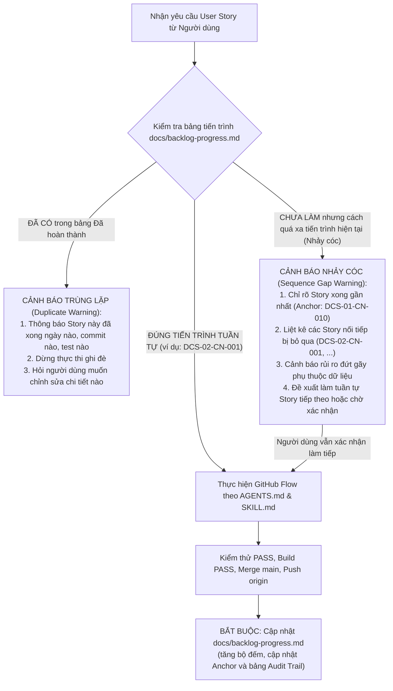

# BẢNG THEO DÕI TIẾN TRÌNH PRODUCT BACKLOG (BACKLOG PROGRESS TRACKER)

> Tài liệu nguồn sự thật ghi nhận toàn bộ tiến trình thực thi 114 User Stories thuộc dự án **Địa Chính Số (Sổ Đỏ Số & CSDL Thửa Đất Thời Gian Thực)**.
> Được tham chiếu trực tiếp tại [AGENTS.md](file:///E:/personal_project/DIACHINHSO/AGENTS.md) và [.agents/skills/user-story-runner/SKILL.md](file:///E:/personal_project/DIACHINHSO/.agents/skills/user-story-runner/SKILL.md).

---

## 1. Tổng Quan Tiến Độ Dự Án (Overall Progress Metrics)

| Chỉ số | Số lượng | Tỷ lệ (%) | Ghi chú |
|---|---|---|---|
| **Tổng số User Stories** | **114** | **100%** | Toàn bộ 114 User Stories được số hóa tại `user_stories/` |
| **Đã hoàn thành (Done)** | **10** | **8.8%** | Đã hoàn thành 100% Epic DCS-01 (10/10 Stories) gồm Shared, API, Web, Tests & Docs |
| **Đang thực hiện (In Progress)** | **0** | **0.0%** | Không có Story nào đang dở dang |
| **Chưa thực hiện (Backlog)** | **104** | **91.2%** | Sẵn sàng triển khai theo thứ tự ưu tiên (Bắt đầu Epic DCS-02) |

- **User Story hoàn thành gần nhất**: [`DCS-01-CN-010`](file:///E:/personal_project/DIACHINHSO/user_stories/DCS-01-CN-010.md) - Nhật ký xác thực và phát hiện cảnh báo đăng nhập bất thường *(Hoàn tất toàn diện 10/10 Stories của Epic DCS-01)*.
- **User Story đề xuất tiếp theo (Next Immediate Story)**: [`DCS-02-CN-001`](file:///E:/personal_project/DIACHINHSO/user_stories/DCS-02-CN-001.md) - Tra cứu quy hoạch và dữ liệu địa chính thửa đất đa lớp trên nền bản đồ số VN-2000 *(Khởi động Epic DCS-02)*.

---

## 2. Danh Sách User Stories Đã Hoàn Thành (Completed Stories Audit Trail)

| Mã Story | Tên User Story | Ngày hoàn thành | Nhánh / Commit chính | API Endpoints | Route Web | Tests | Trạng thái |
|---|---|---|---|---|---|---|---|
| [`DCS-01-CN-001`](file:///E:/personal_project/DIACHINHSO/user_stories/DCS-01-CN-001.md) | Đăng nhập Cổng Định danh Số công dân qua CCCD và OTP SMS | 2026-10-19 | `main` (`666d6b0`, `22c895f`, `e9f5b4e`, `1861544`) | `POST /api/v1/auth/citizen/send-otp` `POST /api/v1/auth/citizen/verify-otp` | `/login` (Tab Công dân) | 13 tests PASS | **Hoàn thành** |
| [`DCS-01-CN-002`](file:///E:/personal_project/DIACHINHSO/user_stories/DCS-01-CN-002.md) | Đăng nhập SSO tài khoản công vụ cho cán bộ ngành | 2026-10-21 | `main` (`7bbcaba`, `e3024de`, `f623330`, `76a44f8`) | `POST /api/v1/auth/officer/login` `POST /api/v1/auth/officer/verify-mfa` | `/login` (Tab Cán bộ công vụ) | 9 tests PASS | **Hoàn thành** |
| [`DCS-01-CN-003`](file:///E:/personal_project/DIACHINHSO/user_stories/DCS-01-CN-003.md) | Phân quyền truy cập dữ liệu địa chính theo cấp hành chính (2 cấp: Tỉnh & Xã, 34 tỉnh thành) | 2026-10-21 *(Cập nhật 2 cấp: 2026-10-22)* | `main` (`d9a5c1f`, `a4cccf3`, `65dc1ef`, `883f27d`, `da0cb46`, `655e4a0`, `b19c191`) | `GET /api/v1/jurisdiction/provinces` `GET /api/v1/jurisdiction/communes` `POST /api/v1/jurisdiction/verify-access` `GET /api/v1/jurisdiction/officers/:id` | `/jurisdiction` | 14 tests PASS | **Hoàn thành** |
| [`DCS-01-CN-004`](file:///E:/personal_project/DIACHINHSO/user_stories/DCS-01-CN-004.md) | Tích hợp chứng thư số chuyên dùng công vụ và SmartCA | 2026-10-22 | `main` (feature `DCS-01-CN-004`) | `GET /api/v1/digital-signature/certificates` `GET /api/v1/digital-signature/ocsp-check/:serialNumber` `GET /api/v1/digital-signature/pending-dossiers` `POST /api/v1/digital-signature/sign-approval` `POST /api/v1/digital-signature/verify` | `/digital-signature` | 17 tests PASS | **Hoàn thành** |
| [`DCS-01-CN-005`](file:///E:/personal_project/DIACHINHSO/user_stories/DCS-01-CN-005.md) | Quản lý phiên làm việc và bảo mật xác thực 2FA | 2026-10-22 | `main` (feature `DCS-01-CN-005`) | `POST /api/v1/session-security/step-up/challenge` `POST /api/v1/session-security/step-up/verify` `POST /api/v1/session-security/unlock` `POST /api/v1/session-security/terminate` `POST /api/v1/session-security/heartbeat` `GET /api/v1/session-security/active` `GET /api/v1/session-security/alerts` | `/session-security` | 16 tests PASS | **Hoàn thành** |
| [`DCS-01-CN-006`](file:///E:/personal_project/DIACHINHSO/user_stories/DCS-01-CN-006.md) | Khóa và vô hiệu hóa tài khoản công vụ khi điều chuyển công tác | 2026-10-22 | `main` (feature `DCS-01-CN-006`) | `GET /api/v1/officer-lifecycle/officers` `GET /api/v1/officer-lifecycle/officers/:id` `GET /api/v1/officer-lifecycle/officers/:id/eligible-transferees` `POST /api/v1/officer-lifecycle/deactivate` `POST /api/v1/officer-lifecycle/transfer-dossiers` `POST /api/v1/officer-lifecycle/reactivate` `GET /api/v1/officer-lifecycle/audit-logs` | `/officer-lifecycle` | 15 tests PASS | **Hoàn thành** |
| [`DCS-01-CN-007`](file:///E:/personal_project/DIACHINHSO/user_stories/DCS-01-CN-007.md) | Cấu hình chính sách mật khẩu và chống tấn công dò quét | 2026-10-22 | `main` (feature `DCS-01-CN-007`) | `GET /api/v1/password-policy/config` `PUT /api/v1/password-policy/config` `POST /api/v1/password-policy/validate-password` `GET /api/v1/password-policy/blocked-ips` `POST /api/v1/password-policy/unblock-ip` `GET /api/v1/password-policy/audit-logs` | `/password-policy` | 12 tests PASS | **Hoàn thành** |
| [`DCS-01-CN-008`](file:///E:/personal_project/DIACHINHSO/user_stories/DCS-01-CN-008.md) | Quản lý ủy quyền giải quyết hồ sơ địa chính có thời hạn | 2026-10-22 | `main` (feature `DCS-01-CN-008`) | `GET /api/v1/delegation/list` `GET /api/v1/delegation/:id` `POST /api/v1/delegation/create` `POST /api/v1/delegation/revoke` `POST /api/v1/delegation/verify-access` `GET /api/v1/delegation/audit/logs` | `/delegation` | 8 tests PASS | **Hoàn thành** |
| [`DCS-01-CN-009`](file:///E:/personal_project/DIACHINHSO/user_stories/DCS-01-CN-009.md) | Đăng nhập và phân quyền tài khoản tổ chức qua Cổng Định danh Doanh nghiệp | 2026-10-22 | `main` (feature `DCS-01-CN-009`) | `POST /api/v1/enterprise-idp/login` `GET /api/v1/enterprise-idp/profile/:taxCode` `GET /api/v1/enterprise-idp/parcels/:taxCode` `POST /api/v1/enterprise-idp/staff/assign` `POST /api/v1/enterprise-idp/staff/remove` `GET /api/v1/enterprise-idp/audit/logs` | `/enterprise` | 10 tests PASS | **Hoàn thành** |
| [`DCS-01-CN-010`](file:///E:/personal_project/DIACHINHSO/user_stories/DCS-01-CN-010.md) | Nhật ký xác thực và phát hiện cảnh báo đăng nhập bất thường | 2026-10-22 | `main` (feature `DCS-01-CN-010`) | `GET /api/v1/auth-audit/logs` `GET /api/v1/auth-audit/alerts` `GET /api/v1/auth-audit/stats` `GET /api/v1/auth-audit/verify-chain` `POST /api/v1/auth-audit/simulate` `POST /api/v1/auth-audit/alerts/resolve` | `/auth-audit` | 11 tests PASS | **Hoàn thành** |

---

## 3. Chi Tiết Đóng Gói Từng User Story Đã Xong

### 3.1. [DCS-01-CN-001] Đăng nhập Cổng Định danh Số công dân qua CCCD và OTP SMS
- **Persona**: Người sử dụng đất (Công dân)
- **Kiến trúc triển khai**:
  - `packages/shared`: Khai báo schemas `SendOtpSchema`, `VerifyOtpSchema`, `CitizenAuthResponse`.
  - `apps/api`: Service `CitizenAuthService` tích hợp Mock Sandbox Citizen IdP, gửi mã OTP 6 số (hạn 5 phút, tối đa 5 lần thử), tạo JWT Bearer Token kèm mã băm SHA-256 Audit Trail.
  - `apps/web`: Route `/login` với tab "Công dân", nhập CCCD 12 số, nhập OTP 6 số, hiển thị màn hình định danh và Ví số giấy tờ đất đai.
  - `tests`: 13 test cases bao phủ đầy đủ 4 Tiêu chí chấp nhận (TC-01, TC-02, TC-03, TC-04).
- **Tài liệu API**: Đã ghi nhận tại [`docs/api-endpoints.md`](file:///E:/personal_project/DIACHINHSO/docs/api-endpoints.md#dcs-01-cn-001-gui-ma-otp-xac-thuc-cong-dan).

### 3.2. [DCS-01-CN-002] Đăng nhập SSO tài khoản công vụ cho cán bộ ngành
- **Persona**: Cán bộ Địa chính xã/phường, Văn phòng Đăng ký Đất đai, Sở TN&MT, Thanh tra Bộ, Quản trị viên
- **Kiến trúc triển khai**:
  - `packages/shared`: Khai báo schemas `OfficerLoginSchema`, `OfficerMfaSchema`, vai trò công vụ và thẩm quyền đơn vị hành chính.
  - `apps/api`: Service `OfficerAuthService` tích hợp SSO công vụ, xác thực tài khoản công chức, kiểm tra trạng thái hoạt động (QTD-22), kiểm tra MFA TOTP 6 số, giới hạn 3 lần thử, gắn mã băm SHA-256 kiểm toán.
  - `apps/web`: Route `/login` với tab "Cán bộ công vụ", nhập email công vụ/tên đăng nhập, mật khẩu, và mã xác thực MFA 2 bước, hiển thị thẻ thông tin công vụ và quyền hạn phân công.
  - `tests`: 9 test cases bao phủ 4 Tiêu chí chấp nhận (TC-01, TC-02, TC-03, TC-04).
  - UI Writing: 100% ẩn các ID nội bộ kỹ thuật (`VT-xx`, `QTD-xx`, `AC-xx`).
- **Tài liệu API**: Đã ghi nhận tại [`docs/api-endpoints.md`](file:///E:/personal_project/DIACHINHSO/docs/api-endpoints.md#dcs-01-cn-002-dang-nhap-can-bo-cong-vu-sso).

### 3.3. [DCS-01-CN-003] Phân quyền truy cập dữ liệu địa chính theo cấp hành chính
- **Persona**: Cán bộ các cấp quản lý hành chính
- **Kiến trúc triển khai**:
  - **Mô hình chính quyền 2 cấp**: Cấp Tỉnh/TP trực thuộc Trung ương và Cấp Xã/Phường/Thị trấn trực thuộc (bỏ hoàn toàn cấp Quận/Huyện theo chỉ đạo mới).
  - **Dữ liệu 34 tỉnh thành**: 23 tỉnh sáp nhập mới (Tuyên Quang, Lào Cai, Thái Nguyên, Phú Thọ, Bắc Ninh, Hưng Yên, TP. Hải Phòng, Ninh Bình, Quảng Trị, TP. Đà Nẵng, Quảng Ngãi, Gia Lai, Khánh Hòa, Lâm Đồng, Đắk Lắk, TP. Hồ Chí Minh, TP. Đồng Nai, Tây Ninh, TP. Cần Thơ, Vĩnh Long, Đồng Tháp, Cà Mau, An Giang) và 11 tỉnh thành giữ nguyên (Hà Nội, Huế, Lai Châu, Điện Biên, Sơn La, Lạng Sơn, Quảng Ninh, Thanh Hóa, Nghệ An, Hà Tĩnh, Cao Bằng).
  - `packages/shared`: Khai báo `AdminJurisdictionLevel` (2 cấp: `PROVINCE`, `COMMUNE`), enum `VietnamProvinceCode` (34 tỉnh thành), danh sách xã trực thuộc.
  - `apps/api`: Service `JurisdictionService` xác thực truy cập địa giới (QTD-16), chặn truy cập vượt cấp, trả về ma trận thẩm quyền phân cấp, lưu vết kiểm toán SHA-256.
  - `apps/web`: Route `/jurisdiction` tra cứu danh mục 34 tỉnh thành, danh mục xã phường, ma trận phân quyền 2 cấp, kiểm tra thẩm quyền địa giới trực quan. Ẩn toàn bộ mã nội bộ kỹ thuật.
  - `tests`: 14 test cases bao phủ 4 Tiêu chí chấp nhận (TC-01, TC-02, TC-03, TC-04).
- **Tài liệu API**: Đã ghi nhận tại [`docs/api-endpoints.md`](file:///E:/personal_project/DIACHINHSO/docs/api-endpoints.md#dcs-01-cn-003-tra-cuu-danh-sach-tinh-thanh-pho-2-cap-hanh-chinh).

### 3.4. [DCS-01-CN-004] Tích hợp chứng thư số chuyên dùng công vụ và SmartCA
- **Persona**: Văn phòng Đăng ký Đất đai (`LAND_REGISTRAR`)
- **Kiến trúc triển khai**:
  - `packages/shared`:
    - Enums `DigitalSignatureProvider` (Ban Cơ yếu Chính phủ, VNPT SmartCA, Viettel-CA, FPT SmartCA, USB Token PKCS#11), `SignatureStandard` (PADES, CADES, XADES), `OcspCertificateStatus` (VALID, REVOKED, EXPIRED).
    - Interfaces `PublicOfficerCertificate`, `SignDossierApprovalRequest`, `SignDossierApprovalResponse`, `VerifyDigitalSignatureRequest`, `PendingDossierForSigning`.
    - Zod schemas `SignDossierApprovalSchema`, `VerifyDigitalSignatureSchema`.
  - `apps/api`:
    - Service `DigitalSignatureService` cung cấp kiểm tra trực tuyến trạng thái thu hồi chứng thư số qua giao thức OCSP (QTD-28), kiểm soát thẩm quyền ký duyệt của Lãnh đạo Văn phòng ĐKĐĐ (QTD-05), chặn ký duyệt hồ sơ khi thửa đất đang bị khóa hoặc có tranh chấp ranh giới, sinh chữ ký số PAdES kèm dấu thời gian TSA RFC 3161 và lưu nhật ký kiểm toán bất biến SHA-256.
    - Controller `DigitalSignatureController` cung cấp 5 REST endpoints chuẩn hóa.
    - Module `DigitalSignatureModule` tích hợp vào `AppModule`.
  - `apps/web`:
    - Route `/digital-signature` với giao diện chuyên biệt cho Văn phòng ĐKĐĐ: Tra cứu & lọc hồ sơ địa chính chờ ký duyệt, modal ký số chuyên dùng công vụ kèm live OCSP status indicator, nhập mã PIN, mô phỏng 4 bước ký số trực tuyến, và modal hiển thị con dấu số điện tử trang trọng kèm chức năng xác minh chữ ký số trực tuyến.
    - Đảm bảo 100% ẩn các ID nội bộ kỹ thuật (`VT-xx`, `QTD-xx`, `DCS-xx`, `AC-xx`).
  - `tests`: 17 test cases bao phủ đầy đủ 4 Tiêu chí chấp nhận (TC-01, TC-02, TC-03, TC-04).
- **Tài liệu API**: Đã ghi nhận tại [`docs/api-endpoints.md`](file:///E:/personal_project/DIACHINHSO/docs/api-endpoints.md#9-nhom-api-ky-so-chuyen-dung-cong-vu--smartca-digital-signature--smartca).

### 3.5. [DCS-01-CN-005] Quản lý phiên làm việc và bảo mật xác thực 2FA
- **Persona**: Quản trị viên Hệ thống (`ADMIN`) / Cán bộ công vụ
- **Kiến trúc triển khai**:
  - `packages/shared`:
    - Enums `SessionStatus` (ACTIVE, LOCKED_INACTIVITY, SUSPENDED_SECURITY, TERMINATED), `SensitiveOperationType` (APPROVE_CERTIFICATE, ALTER_PARCEL_BOUNDARY, BULK_DATA_EXPORT, REVOKE_DOCUMENT).
    - Interfaces `UserSession`, `StepUp2FaChallengeRequest/Response`, `VerifyStepUp2FaRequest/Response`, `UnlockSessionRequest/Response`, `TerminateSessionRequest/Response`, `SecurityViolationAlert`.
    - Zod schemas `StepUp2FaChallengeSchema`, `VerifyStepUp2FaSchema`, `UnlockSessionSchema`, `TerminateSessionSchema`.
  - `apps/api`:
    - Service `SessionSecurityService`:
      - Quản lý phiên công vụ, tự động khóa sau 15 phút (900s) không tương tác (inactivity timeout).
      - Mở khóa phiên làm việc bằng PIN hoặc 2FA, đếm số lần sai; mở khóa thành công gia hạn phiên làm việc thêm 15 phút.
      - Thử thách bảo mật 2 lớp (Step-Up 2FA Challenge) khi thao tác nhạy cảm (duyệt cấp GCN, thay đổi ranh giới thửa đất, xuất dữ liệu hàng loạt, thu hồi hồ sơ), cấp `stepUpToken` dùng một lần có hạn 5 phút.
      - Tự động phát hiện vi phạm bảo mật theo quy tắc an toàn thông tin (QTD-22): đình chỉ phiên ngay lập tức (`SUSPENDED_SECURITY`) khi truy cập từ IP ngoài mạng công vụ hoặc nhập sai mã quá 3 lần liên tiếp.
      - Ghi vết kiểm toán bất biến kèm mã băm SHA-256 cho toàn bộ vòng đời phiên làm việc.
    - Controller `SessionSecurityController` cung cấp 7 REST endpoints chuẩn hóa.
    - Module `SessionSecurityModule` tích hợp vào `AppModule`.
  - `apps/web`:
    - Route `/session-security` hiển thị bảng điều khiển bảo mật phiên làm việc: giám sát phiên công vụ đang hoạt động, bộ đếm ngược tự động khóa 15 phút, thao tác kiểm tra cơ chế mở khóa phiên (Unlock Modal), chạy giả lập thử thách Step-Up 2FA cho thao tác nhạy cảm, và bảng ghi nhật ký cảnh báo an ninh thời gian thực.
    - Đảm bảo 100% ẩn các ID nội bộ kỹ thuật (`VT-xx`, `QTD-xx`, `DCS-xx`, `AC-xx`).
  - `tests`: 16 test cases bao phủ đầy đủ 4 Tiêu chí chấp nhận (TC-01, TC-02, TC-03, TC-04).
- **Tài liệu API**: Đã ghi nhận tại [`docs/api-endpoints.md`](file:///E:/personal_project/DIACHINHSO/docs/api-endpoints.md#10-nhom-api-quan-ly-phien-lam-viec-va-bao-mat-xac-thuc-2fa-session-security--2fa).

### 3.6. [DCS-01-CN-006] Khóa và vô hiệu hóa tài khoản công vụ khi điều chuyển công tác
- **Persona**: Quản trị viên Hệ thống (`ADMIN`)
- **Kiến trúc triển khai**:
  - `packages/shared`:
    - Enums `OfficerAccountStatus` (ACTIVE, TRANSFERRED, SUSPENDED_DISCIPLINE, DISMISSED, RESIGNED), `DeactivationReasonType` (TRANSFER, DISMISSAL, DISCIPLINE, RESIGNATION).
    - Interfaces `OfficerAccountItem`, `DeactivationInfo`, `DeactivateOfficerAccountRequest/Response`, `TransferDossiersRequest/Response`, `ReactivateOfficerAccountRequest/Response`.
    - Zod schemas `DeactivateOfficerAccountSchema`, `TransferDossiersSchema`, `ReactivateOfficerAccountSchema`.
  - `apps/api`:
    - Service `OfficerLifecycleService`:
      - Vô hiệu hóa và thu hồi quyền tài khoản công vụ tức thì khi có quyết định hành chính (điều chuyển, thôi việc, miễn nhiệm, kỷ luật).
      - Chống self-lockout: ngăn chặn Quản trị viên tự khóa tài khoản của chính mình.
      - Chấm dứt tất cả các phiên làm việc đang hoạt động (force logout).
      - Tự động bàn giao các hồ sơ địa chính dở dang sang cán bộ tiếp nhận đủ điều kiện hoạt động (`ACTIVE`).
      - Hỗ trợ thủ tục chuyển giao hồ sơ độc lập và khôi phục tài khoản khi hết thời hạn đình chỉ.
      - Ghi nhận nhật ký kiểm toán bất biến kèm mã băm SHA-256 cho từng thao tác.
    - Controller `OfficerLifecycleController` cung cấp 7 REST endpoints chuẩn hóa.
    - Module `OfficerLifecycleModule` tích hợp vào `AppModule`.
  - `apps/web`:
    - Route `/officer-lifecycle`: Bảng quản lý nhân sự địa chính theo dõi trạng thái công tác, số lượng hồ sơ dở dang, tìm kiếm lọc cán bộ, modal nhập quyết định điều chuyển và chọn cán bộ bàn giao, modal khôi phục tài khoản, và bảng nhật ký kiểm toán bất biến.
    - Đảm bảo 100% ẩn các ID nội bộ kỹ thuật (`VT-xx`, `QTD-xx`, `DCS-xx`, `AC-xx`).
  - `tests`: 15 test cases bao phủ đầy đủ 4 Tiêu chí chấp nhận (TC-01, TC-02, TC-03, TC-04).
- **Tài liệu API**: Đã ghi nhận tại [`docs/api-endpoints.md`](file:///E:/personal_project/DIACHINHSO/docs/api-endpoints.md#11-nhom-api-quan-ly-vong-doi--dieu-chuyen-can-bo-cong-vu-officer-lifecycle--account-deactivation).

### 3.7. [DCS-01-CN-007] Cấu hình chính sách mật khẩu và chống tấn công dò quét
- **Persona**: Quản trị viên Hệ thống (`ADMIN`)
- **Kiến trúc triển khai**:
  - `packages/shared`:
    - Interfaces `PasswordPolicyConfig`, `BlockedIpItem`, `UpdatePasswordPolicyRequest`, `ValidatePasswordRequest/Response`, `UnblockIpRequest/Response`.
    - Zod schemas `UpdatePasswordPolicySchema`, `ValidatePasswordSchema`, `UnblockIpSchema`.
  - `apps/api`:
    - Service `PasswordPolicyService`:
      - Thiết lập và cập nhật chính sách độ phức tạp mật khẩu công vụ (độ dài 8-32, 4 nhóm ký tự, hạn đổi mật khẩu 15-365 ngày, lưu lịch sử 1-24 mật khẩu cũ).
      - Đánh giá độ mạnh mật khẩu theo thời gian thực (Password Strength Validator).
      - Cơ chế chống tấn công dò quét (Brute-Force & Rate Limiting): tự động khóa IP và tài khoản khi nhập sai liên tiếp vượt ngưỡng `maxFailedAttempts` trong `lockoutDurationMinutes`.
      - Mở khóa thủ công địa chỉ IP bị chặn và ghi nhận nhật ký kiểm toán bất biến SHA-256.
    - Controller `PasswordPolicyController` cung cấp 6 REST endpoints chuẩn hóa.
    - Module `PasswordPolicyModule` tích hợp vào `AppModule`.
  - `apps/web`:
    - Route `/password-policy`: Form cấu hình chính sách mật khẩu và hạn ngạch thử sai, công cụ kiểm tra độ mạnh mật khẩu trực quan với thanh điểm an toàn, bảng danh sách địa chỉ IP bị khóa tự động kèm thao tác mở khóa (Unblock Modal), và bảng nhật ký kiểm toán thay đổi cấu hình.
    - Đảm bảo 100% ẩn các ID nội bộ kỹ thuật (`VT-xx`, `QTD-xx`, `DCS-xx`, `AC-xx`).
  - `tests`: 12 test cases bao phủ đầy đủ 4 Tiêu chí chấp nhận (TC-01, TC-02, TC-03, TC-04).
- **Tài liệu API**: Đã ghi nhận tại [`docs/api-endpoints.md`](file:///E:/personal_project/DIACHINHSO/docs/api-endpoints.md#12-nhom-api-cau-hinh-chinh-sach-mat-khau--chong-tan-cong-do-quet-password-policy--brute-force-protection).

### 3.8. [DCS-01-CN-008] Quản lý ủy quyền giải quyết hồ sơ địa chính có thời hạn
- **Persona**: Văn phòng Đăng ký Đất đai (`LAND_REGISTRAR`)
- **Kiến trúc triển khai**:
  - `packages/shared`:
    - Enums `DelegationScope` (ALL_DOSSIERS, APPROVE_CERTIFICATE, SIGN_TRANSFER, SIGN_SURVEY_EXTRACT), `DelegationStatus` (ACTIVE, PENDING, EXPIRED, REVOKED).
    - Interfaces `DelegationDocument`, `CreateDelegationRequest/Response`, `RevokeDelegationRequest/Response`, `VerifyDelegationAccessRequest/Response`.
    - Zod schemas `CreateDelegationSchema`, `RevokeDelegationSchema`, `VerifyDelegationAccessSchema`.
  - `apps/api`:
    - Service `DelegationService`:
      - Ban hành quyết định ủy quyền giải quyết hồ sơ có thời hạn cho cấp phó ký thay khi Lãnh đạo đi công tác.
      - Tự động kiểm tra thời hạn và cập nhật vòng đời (`ACTIVE`, `PENDING`, `EXPIRED`).
      - Xác thực thẩm quyền ủy quyền trực tuyến khi cán bộ thực hiện ký duyệt (`verifyDelegationAccess`), tự động gắn chức danh ký thay "KT. GIÁM ĐỐC - PHÓ GIÁM ĐỐC".
      - Hỗ trợ thu hồi ủy quyền trước thời hạn kèm mã băm SHA-256 lưu vết kiểm toán bất biến.
    - Controller `DelegationController` cung cấp 6 REST endpoints chuẩn hóa.
    - Module `DelegationModule` tích hợp vào `AppModule`.
  - `apps/web`:
    - Route `/delegation`: Quản lý danh mục văn bản ủy quyền, modal tạo mới quyết định ủy quyền kèm chọn cấp phó và phạm vi nghiệp vụ, modal thu hồi ủy quyền, và mô phỏng ký thay duyệt hồ sơ có gắn con dấu điện tử "KT. GIÁM ĐỐC".
    - Đảm bảo 100% ẩn các ID nội bộ kỹ thuật (`VT-xx`, `QTD-xx`, `DCS-xx`, `AC-xx`).
  - `tests`: 8 test cases bao phủ đầy đủ 4 Tiêu chí chấp nhận (TC-01, TC-02, TC-03, TC-04).
- **Tài liệu API**: Đã ghi nhận tại [`docs/api-endpoints.md`](file:///E:/personal_project/DIACHINHSO/docs/api-endpoints.md#13-nhom-api-quan-ly-uy-quyen-giai-quyet-ho-so-dia-chinh-co-thoi-han-timed-delegation).

### 3.9. [DCS-01-CN-009] Đăng nhập và phân quyền tài khoản tổ chức qua Cổng Định danh Doanh nghiệp
- **Persona**: Chủ sử dụng đất (Doanh nghiệp, Tổ chức kinh tế)
- **Kiến trúc triển khai**:
  - `packages/shared`:
    - Enums `EnterpriseStaffPermission` (SUBMIT_DOSSIER, TRACK_PROGRESS, VIEW_LAND_DATA, REQUEST_CERTIFICATE_EXTRACT, PAY_LAND_TAX), `EnterpriseAuthMethod` (USB_TOKEN, HSM_CLOUD).
    - Interfaces `EnterpriseStaffMember`, `EnterpriseProjectParcel`, `EnterpriseAccount`, `EnterpriseLoginRequest/Response`, `AssignEnterpriseStaffRequest/Response`, `RemoveEnterpriseStaffRequest/Response`.
    - Zod schemas `EnterpriseLoginSchema`, `AssignEnterpriseStaffSchema`, `RemoveEnterpriseStaffSchema`.
  - `apps/api`:
    - Service `EnterpriseIdpService`:
      - Xác thực đăng nhập doanh nghiệp bằng Mã số thuế và Chữ ký số USB Token / HSM (PKCS#11).
      - Tra cứu danh mục các thửa đất dự án do doanh nghiệp đứng tên quyền sử dụng hợp pháp (chặn truy cập thửa đất ngoài phạm vi dự án).
      - Phân quyền cho nhân sự nội bộ (Chuyên viên Pháp lý Dự án, Giám đốc Phát triển Dự án) nộp và theo dõi tiến độ hồ sơ địa chính kèm thời hạn phân quyền.
      - Thu hồi quyền nhân sự và ghi nhận nhật ký kiểm toán bất biến SHA-256.
    - Controller `EnterpriseIdpController` cung cấp 6 REST endpoints chuẩn hóa.
    - Module `EnterpriseIdpModule` tích hợp vào `AppModule`.
  - `apps/web`:
    - Route `/enterprise`: Cổng thông tin đất đai doanh nghiệp trực tuyến, xác thực chứng thư số doanh nghiệp, thẻ thông tin đại diện pháp luật, bảng danh mục thửa đất dự án, giao diện phân quyền nhân sự kèm bộ chọn quyền hạn, và bảng nhật ký kiểm toán bất biến.
    - Đảm bảo 100% ẩn các ID nội bộ kỹ thuật (`VT-xx`, `QTD-xx`, `DCS-xx`, `AC-xx`).
  - `tests`: 10 test cases bao phủ đầy đủ 4 Tiêu chí chấp nhận (TC-01, TC-02, TC-03, TC-04).
- **Tài liệu API**: Đã ghi nhận tại [`docs/api-endpoints.md`](file:///E:/personal_project/DIACHINHSO/docs/api-endpoints.md#14-nhom-api-dang-nhap--phan-quyen-tai-khoan-to-chuc-qua-cong-dinh-danh-doanh-nghiep-dcs-01-cn-009).

### 3.10. [DCS-01-CN-010] Nhật ký xác thực và phát hiện cảnh báo đăng nhập bất thường
- **Persona**: Quản trị viên Hệ thống (`ADMIN`) / Thanh tra & Giám sát An toàn thông tin (`INSPECTOR`)
- **Ý nghĩa cột mốc**: **Chính thức hoàn thành 100% Epic DCS-01** (10/10 User Stories) về Quản lý định danh số, xác thực đa kênh và phân quyền liên ngành.
- **Kiến trúc triển khai**:
  - `packages/shared`:
    - Enums `AuthAuditLogStatus` (SUCCESS, FAILED, CHALLENGED, BLOCKED), `AuthMethodType` (CITIZEN_IDP, OFFICER_SSO, ENTERPRISE_TOKEN, SMART_CA), `AnomalyDetectionType` (IMPOSSIBLE_TRAVEL, OFF_HOURS_ACCESS, BRUTE_FORCE_BURST, UNTRUSTED_NETWORK, SUSPICIOUS_DEVICE), `AnomalySeverity` (LOW, MEDIUM, HIGH, CRITICAL), `AnomalyAlertStatus` (NEW, INVESTIGATING, RESOLVED, FALSE_POSITIVE).
    - Interfaces `AuthAuditLogItem`, `AnomalySecurityAlert`, `QueryAuthAuditLogsRequest`, `QueryAnomalyAlertsRequest`, `ResolveAnomalyAlertRequest/Response`, `SimulateAuthEventRequest`, `VerifyAuditChainResponse`.
    - Zod schemas `QueryAuthAuditLogsSchema`, `QueryAnomalyAlertsSchema`, `ResolveAnomalyAlertSchema`, `SimulateAuthEventSchema`.
  - `apps/api`:
    - Service `AuthAuditService`:
      - Sổ cái kiểm toán bất biến liên kết chuỗi băm SHA-256 (QTD-20) liên tục xác thực tính toàn vẹn `previousHash` và `auditHash`, phát hiện tức thì các khối dữ liệu bị sửa đổi hoặc giả mạo.
      - Thuật toán phát hiện dị thường thông minh (Anomaly Engine):
        - *Di chuyển bất khả thi (Impossible Travel)*: Đăng nhập từ 2 địa phương cách xa nhau (> 300km hoặc khác quốc gia) trong khoảng thời gian quá ngắn (< 60 phút) -> Chặn truy cập (`BLOCKED`), phát cảnh báo `CRITICAL` và tự động khóa tài khoản.
        - *Đăng nhập ngoài giờ hành chính (Off-hours Access)*: Cán bộ đăng nhập vào ban đêm (23:00 - 05:00) -> Chuyển trạng thái `CHALLENGED`, phát cảnh báo `MEDIUM` và yêu cầu thử thách 2FA tăng cường.
        - *Mạng ngoài công vụ (Untrusted Network - QTD-22)*: Cán bộ đăng nhập từ IP lạ ngoài dải CPNET (`10.x.x.x` hoặc `192.168.1.x`) -> Tự động chặn và phát cảnh báo `HIGH`.
        - *Tấn công dò quét dồn dập (Brute-Force Burst)*: Thử sai liên tục vượt ngưỡng an toàn.
      - Xử lý cảnh báo an ninh (`resolveAnomalyAlert`): Khóa vĩnh viễn tài khoản, bác bỏ báo động giả (False Positive), hoặc yêu cầu Step-Up 2FA kèm mã băm lưu vết kiểm toán.
    - Controller `AuthAuditController` cung cấp 6 REST endpoints chuẩn hóa.
    - Module `AuthAuditModule` tích hợp vào `AppModule`.
  - `apps/web`:
    - Route `/auth-audit`: Trung tâm Giám sát Xác thực & SOC Dashboard thời gian thực, gồm 4 thẻ KPI chỉ số an ninh, 3 Tab nghiệp vụ chuyên sâu:
      1. *Cảnh báo an ninh dị thường*: Bộ lọc mức độ nghiêm trọng, danh sách sự cố kèm mã băm SHA-256, Modal xử lý cảnh báo (khóa tài khoản, bác bỏ báo động giả, yêu cầu 2FA).
      2. *Sổ cái kiểm toán chuỗi băm*: Bảng theo dõi các khối dữ liệu bất biến kèm công cụ kiểm tra toàn vẹn chuỗi (Chain Integrity Verification).
      3. *Công cụ kiểm thử dị thường*: Trình mô phỏng 4 kịch bản tấn công/dị thường thực tế để kiểm tra khả năng phản ứng tự động của hệ thống.
    - Đảm bảo 100% ẩn các ID nội bộ kỹ thuật (`VT-xx`, `QTD-xx`, `DCS-xx`, `AC-xx`).
  - `tests`: 11 test cases bao phủ đầy đủ 4 Tiêu chí chấp nhận (TC-01, TC-02, TC-03, TC-04).
- **Tài liệu API**: Đã ghi nhận tại [`docs/api-endpoints.md`](file:///E:/personal_project/DIACHINHSO/docs/api-endpoints.md#15-nhom-api-nhat-ky-xac-thuc--phat-hien-canh-bao-dang-nhap-bat-thuong-dcs-01-cn-010).

---

## 4. Cơ Chế Kiểm Soát Tiến Trình Dành Cho Agent (Gatekeeper Protocol)

Trước khi thực thi bất kỳ User Story nào, Agent **BẮT BUỘC** thực hiện quy trình tra cứu bảng tiến trình này:

### 4.1. Quy tắc 1: Cảnh báo Trùng lặp (Duplicate Detection)
- **Điều kiện kích hoạt**: Khi User Story yêu cầu đã có mặt trong **Mục 2: Danh Sách User Stories Đã Hoàn Thành**.
- **Hành động của Agent**:
  - **TUYỆT ĐỐI KHÔNG** tự ý code lại từ đầu hoặc chạy lại flow làm đè hỏng mã nguồn đã có.
  - Lập tức gửi cảnh báo đến người dùng:
    > "User Story `[MÃ_STORY]` đã được hoàn thành trước đó vào ngày `[NGÀY]`, commit `[COMMIT_ID]`, với `[X]` test cases đã PASS và giao diện tại `[ROUTE]`. Nếu bạn muốn cập nhật logic hoặc bổ sung chức năng mới cho Story này, vui lòng nêu rõ yêu cầu cụ thể thay vì chạy lại từ đầu."

### 4.2. Quy tắc 2: Cảnh báo Nhảy cóc / Bỏ qua công việc nối tiếp (Sequence Gap Detection)
- **Điều kiện kích hoạt**: Khi User Story được yêu cầu không phải là story kế tiếp nối dài luồng nghiệp vụ hiện tại (ví dụ: đang ở `DCS-01-CN-004` nhưng người dùng yêu cầu làm `DCS-03-CN-001` hoặc `DCS-05-CN-001`, nhảy qua `DCS-01-CN-005`...).
- **Hành động của Agent**:
  - Không tự tiện thực thi ngay lập tức mà gửi cảnh báo phân tích cấu trúc:
    > "⚠️ **Cảnh báo tiến trình Product Backlog**:
    > - Tiến trình hiện tại vừa hoàn thành: `[MÃ_STORY_GẦN_NHẤT]` (`DCS-01-CN-008`).
    > - User Story tiếp theo liền kề theo thiết kế hệ thống là: `[MÃ_STORY_TIẾP_THEO]` (`DCS-01-CN-009`: Đăng nhập và phân quyền tài khoản tổ chức qua Cổng Định danh Doanh nghiệp).
    > - Yêu cầu hiện tại của bạn là `[MÃ_STORY_YÊU_CẦU]` - đang bỏ qua các bước tiền đề liền trước: `[DANH_SÁCH_STORIES_BỊ_BỎ_QUA]`.
    > - **Rủi ro kiến trúc**: `[Giải thích rõ lý do phân quyền / luồng dữ liệu...]`.
    > 
    > **Đề xuất**: Bạn có muốn thực hiện tuần tự `[MÃ_STORY_TIẾP_THEO]` trước để đảm bảo tính toàn vẹn hệ thống, hay bạn vẫn muốn ưu tiên thực hiện trước `[MÃ_STORY_YÊU_CẦU]`?"
  - Chỉ khi người dùng xác nhận rõ ràng muốn làm câu chuyện đó trước, Agent mới bắt đầu triển khai.

### 4.3. Quy tắc 3: Cập nhật Tiến trình Sau Khi Hoàn Thành (Mandatory Post-Execution Logging)
- **Điều kiện kích hoạt**: Mỗi khi một User Story vượt qua toàn bộ tiêu chí (Step 5 pass tests, Step 7 pass build, Step 8 merge main và push remote).
- **Hành động của Agent**:
  - Mở file [`docs/backlog-progress.md`](file:///E:/personal_project/DIACHINHSO/docs/backlog-progress.md).
  - Tăng số lượng `Đã hoàn thành` thêm 1, giảm `Chưa thực hiện` đi 1, tính lại tỷ lệ `%`.
  - Cập nhật dòng `User Story hoàn thành gần nhất` và `User Story đề xuất tiếp theo`.
  - Thêm một hàng mới vào **Mục 2: Danh Sách User Stories Đã Hoàn Thành** và bổ sung chi tiết vào **Mục 3**.
  - Thực hiện commit tài liệu này cùng với mã nguồn story.
